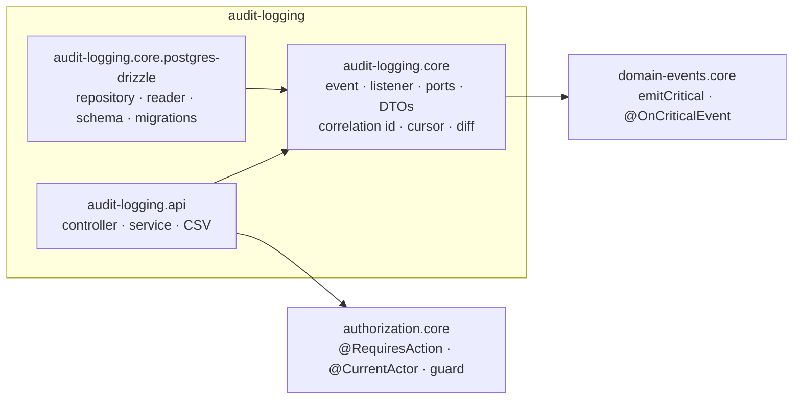
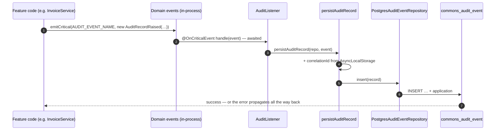
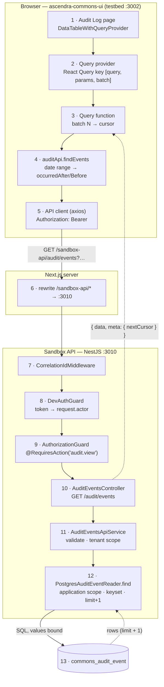

# Audit Logging — Developer Guide

**For:** a developer new to `audit-logging` — to understand how it works end to end, change it safely, and build
the next module the same way. **Covers:** the three backend packages (NestJS), how a consuming app wires them, the
write and read paths, security, data, testing, how-tos, and the 2026-10 backend code review.
**Companion docs:** [`README.md`](./README.md) (what the module is, how to consume it) ·
[`AUDIT-REPORT.md`](./AUDIT-REPORT.md) (review verdict and gaps) ·
[`../MODULE-GUIDE-TEMPLATE.md`](../MODULE-GUIDE-TEMPLATE.md) (what every module's guide covers).

Code excerpts are trimmed (`// …`) but otherwise exactly what's in the files named above them. Paths are relative to
`ascendra-commons/audit-logging/` unless they start with a repo name.

---

## Contents

1. [What it does, in one minute](#1-what-it-does-in-one-minute)
2. [The packages and what depends on what](#2-the-packages-and-what-depends-on-what)
3. [NestJS building blocks used here](#3-nestjs-building-blocks-used-here)
4. [Wiring it into an app](#4-wiring-it-into-an-app)
5. [The write path — how a record is created](#5-the-write-path--how-a-record-is-created)
6. [The read path — one request, end to end](#6-the-read-path--one-request-end-to-end)
7. [Every endpoint](#7-every-endpoint)
8. [Security model](#8-security-model)
9. [Data model, indexes and migrations](#9-data-model-indexes-and-migrations)
10. [Testing](#10-testing)
11. [How to change things](#11-how-to-change-things)
12. [Backend code review (2026-10)](#12-backend-code-review-2026-10)
13. [File map](#13-file-map)

---

## 1. What it does, in one minute

An immutable record of **who did what, to what, when** — for compliance and for investigating "what happened to this
invoice". Feature code raises one event per audited change; the module persists it; an opt-in HTTP API serves it to
the audit screens in `ascendra-commons-ui`.

| Term | Meaning |
|---|---|
| **Audit record** | One row in `commons_audit_event`: entity, actor, action, before/after snapshots, time, reason. Write-once. |
| **Entity** | What changed — `entityType` (`invoice`) + `entityId`. |
| **Action** | The verb only (`status_changed`) — the resource is the entity type. Displayed together as `invoice.status_changed`. |
| **Actor** | Who did it — an id string (`admin@acme.test`, `system:payment-gateway`). |
| **Tenant** | Whose data it is — `tenantId`, or `null` for a platform-level change. |
| **Correlation id** | Shared by every record one request or job run wrote — a "trace". |
| **Application** | Which Ascendra app wrote the row (`ascendra-pay`). Stamped by the adapter, scoped on every read. |

---

## 2. The packages and what depends on what



| Package | Ships | Never depends on |
|---|---|---|
| `audit-logging.core` | `AuditRecordRaised`, `AUDIT_EVENT_NAME`, `AuditListener`, `persistAuditRecord`, the **ports** `AuditEventRepository` (write) and `AuditEventReader` (read), every DTO, correlation-id context + middleware, keyset cursor, field diff, stats helpers, `AuditLoggingModule` | a database, HTTP |
| `audit-logging.core.postgres-drizzle` | `PostgresAuditEventRepository`, `PostgresAuditEventReader`, the Drizzle table, numbered SQL migrations, two modules | HTTP, authorization |
| `audit-logging.api` | `AuditEventsController`, `AuditEventsApiService`, CSV streaming, `AuditApiModule` | a stack adapter — it gets the reader through the `AUDIT_EVENT_READER` port |

The split is **ports and adapters**: `.core` defines interfaces, `.postgres-drizzle` implements them for one stack, and
`.api` only ever talks to the interface. A project on another database writes its own repository/reader and keeps
`.core` and `.api` unchanged. `scripts/check.js` enforces these boundaries on every push.

---

## 3. NestJS building blocks used here

If you know NestJS, skim this. If not, these six ideas are all you need to read the module.

### 3.1 Dynamic modules — `forRoot(config)`

A module with no defaults (which database? which app name?) is configured by the consumer. `forRoot` returns a
module definition built from the config.

```ts
// audit-logging.core/audit-logging.module.ts
@Module({})
export class AuditLoggingModule {
  static forRoot(config: AuditLoggingModuleConfig): DynamicModule {
    return {
      module: AuditLoggingModule,
      imports: config.imports ?? [],
      providers: [{ provide: AUDIT_EVENT_REPOSITORY, useExisting: config.auditEventRepositoryToken }, AuditListener],
      exports: [AUDIT_EVENT_REPOSITORY],
    };
  }
}
```

### 3.2 Injection tokens — symbols, bound with `useExisting` / `useValue`

Every dependency between packages goes through a `Symbol` token, never a class import across a seam — a typo is a
compile error, and the implementation behind a token can be swapped.

```ts
// audit-logging.core/tokens.ts
export const AUDIT_EVENT_REPOSITORY = Symbol('AUDIT_EVENT_REPOSITORY'); // write port
export const AUDIT_EVENT_READER = Symbol('AUDIT_EVENT_READER');         // read port
export const AUDIT_EVENT_NAME = 'audit.record_raised';                  // the one event name
```

```ts
// audit-logging.core.postgres-drizzle/postgres-audit-observability.module.ts
providers: [
  { provide: AUDIT_SQL_EXECUTOR, useExisting: config.sqlExecutorToken },   // the app's own DB connection
  { provide: AUDIT_APPLICATION_ID, useValue: config.application },        // a plain value
  PostgresAuditEventReader,
  { provide: AUDIT_EVENT_READER, useExisting: PostgresAuditEventReader }, // bind the port to the adapter
],
exports: [AUDIT_EVENT_READER],
```

Why `imports` in every config: `useExisting` resolves only tokens the module can already see — its own providers or
its imports — not the whole app. So the consumer passes the module that provides the DB connection
(`imports: [DatabaseModule]`).

### 3.3 Ports — interfaces the core owns

```ts
// audit-logging.core/audit-event-repository.port.ts
export interface AuditEventRepository {
  insert(record: AuditEventInput): Promise<void>; // insert only — write-once by construction
}

// audit-logging.core/audit-event-reader.port.ts (trimmed)
export interface AuditEventReader {
  applications(): string[];
  find(query: AuditQuery): Promise<AuditQueryResult>;
  countUpTo(query: AuditQuery, max: number): Promise<number>;
  findOne(id: string, tenantId?: string | null): Promise<AuditEvent | null>;
  summarizeActor(actor: string, query: ActorActivityQuery): Promise<ActorActivitySummary>;
  overviewStats(window: string, tenantId?: string | null, timeZone?: string): Promise<AuditOverviewStats>;
  topActions(window: string, tenantId?: string | null): Promise<AuditTopActionsStats>;
  retention(tenantId?: string | null): Promise<AuditRetentionStats>;
  countByDeclared(query: AuditCoverageQuery): Promise<AuditCoverageEntry[]>;
}
```

The `SqlExecutor` the Postgres adapter takes is just as small — any Drizzle pg database satisfies it, so the adapter
never imports the consumer's schema:

```ts
// audit-logging.core.postgres-drizzle/persistence/sql-executor.ts
export interface SqlExecutor {
  execute(query: SQL): Promise<{ rows: Array<Record<string, unknown>> }>;
}
```

### 3.4 Guards — who may call

A guard decides whether a request reaches its handler. Two run globally (`APP_GUARD`), **in registration order**:
authentication sets `request.actor`, then `AuthorizationGuard` checks the action the route declares.

```ts
// ascendra-commons-sandbox/src/auth/auth.module.ts
providers: [
  { provide: APP_GUARD, useClass: DevAuthGuard },             // 1. Bearer token → request.actor
  { provide: APP_GUARD, useExisting: AuthorizationGuard },    // 2. @RequiresAction → allowed?
],
```

```ts
// authorization/authorization.core/authorization.guard.ts (trimmed)
async canActivate(context: ExecutionContext): Promise<boolean> {
  const decision = this.declarationFor(context.getHandler()) ?? this.declarationFor(context.getClass());
  if (!decision) throw new AuthorizationNotDeclaredError(/* … */); // deny by default: undeclared route → 500
  if (decision.kind === 'no-action-required') return true;
  const actor = context.switchToHttp().getRequest<{ actor?: Actor }>().actor;
  if (!actor) throw new UnauthorizedException('Sign in to continue.');
  if (!(await this.authorizer.can(actor, decision.action))) {
    throw new ForbiddenException(`You don't have permission for this — it needs "${decision.action}".`);
  }
  return true;
}
```

### 3.5 Decorators — metadata and parameters

```ts
// authorization/authorization.core
export const RequiresAction = (action: string) => SetMetadata(ACTION_METADATA_KEY, action); // read by the guard
export const CurrentActor = createParamDecorator((_d, ctx: ExecutionContext): Actor => {
  const request = ctx.switchToHttp().getRequest<{ actor?: Actor }>();
  if (!request.actor) throw new UnauthorizedException();
  return request.actor;
});
```

### 3.6 Middleware and event listeners

`CorrelationIdMiddleware` runs before guards on every request (applied in the consumer's module, §4). Event
listeners are discovered by NestJS's event emitter: any provider method decorated `@OnEvent(name)` is subscribed.
`@OnCriticalEvent` is `@OnEvent` with `suppressErrors: false` — without it, NestJS logs and **swallows** a listener's
error, and an audit write could fail silently:

```ts
// domain-events/domain-events.core/on-critical-event.decorator.ts
export function OnCriticalEvent(event: string, options?: Omit<OnEventOptions, 'suppressErrors'>) {
  return OnEvent(event, { ...options, suppressErrors: false });
}
```

---

## 4. Wiring it into an app

The sandbox (`ascendra-commons-sandbox`) is the reference consumer. Each commons module gets one config file; one
`CommonsModule` imports them all.

```ts
// ascendra-commons-sandbox/src/modules/commons/audit-logging.ts
const application = process.env.APPLICATION ?? 'ascendra-commons-sandbox';

// Write side: AuditRecordRaised → the shipped AuditListener → Postgres repository.
export const auditLogging = AuditLoggingModule.forRoot({
  auditEventRepositoryToken: POSTGRES_AUDIT_EVENT_REPOSITORY,
  imports: [PostgresAuditPersistenceModule.forRoot({ sqlExecutorToken: DATABASE_CONNECTION, application, imports: [DatabaseModule] })],
});

// Read side: /audit/* endpoints over the Postgres reader, with this app's audit vocabulary.
export const auditApi = AuditApiModule.forRoot({
  catalog: AUDIT_CATALOG, // [{ entityType: 'invoice', actions: ['created', 'issued', …] }, …]
  imports: [PostgresAuditObservabilityModule.forRoot({ sqlExecutorToken: DATABASE_CONNECTION, application, imports: [DatabaseModule] })],
});
```

```ts
// ascendra-commons-sandbox/src/modules/commons/commons.module.ts
@Module({
  imports: [domainEvents, authorization, auditLogging, auditApi],
  exports: [domainEvents, authorization],
})
export class CommonsModule implements NestModule {
  configure(consumer: MiddlewareConsumer) {
    consumer.apply(CorrelationIdMiddleware).forRoutes('*'); // the id a trace groups by
  }
}
```

**Checklist for a new consuming app**

1. `node ascendra-commons.js add audit-logging/audit-logging.core.postgres-drizzle domain-events/domain-events.core.in-process`
   (+ `audit-logging/audit-logging.api` and an authorization model for the screens). Dependencies come along.
2. Apply the delivered migrations with your migration tool (`npm run db:migrate` in the sandbox — drizzle-kit).
3. `DomainEventsModule.forRoot(...)` — the listener is reached through `emitCritical()`.
4. The two `forRoot` calls above, with your DB token and application name.
5. `CorrelationIdMiddleware` on every route.
6. Authentication that sets `request.actor`, then `AuthorizationGuard` as a **global** guard, and a persona with
   `audit.view` (`AUDIT_ACTIONS.VIEW`). See §8 for why the order and the global registration matter.

---

## 5. The write path — how a record is created



**1. Feature code raises the event**, inside the change it audits:

```ts
await this.events.emitCritical(AUDIT_EVENT_NAME,
  new AuditRecordRaised('invoice', invoiceId, tenantId, actorId, 'status_changed',
    { status: previousStatus }, { status: 'paid' }, new Date()));
```

The constructor is positional — `(entityType, entityId, tenantId, actor, action, before, after, occurredAt, reason?)`:

```ts
// audit-logging.core/audit-record-raised.ts
export class AuditRecordRaised implements DomainEvent {
  constructor(
    public readonly entityType: string,
    public readonly entityId: string,
    public readonly tenantId: string | null,
    public readonly actor: string,
    public readonly action: string,
    public readonly before: Record<string, unknown> | null,
    public readonly after: Record<string, unknown> | null,
    public readonly occurredAt: Date,          // the business fact's time, not "now"
    public readonly reason: string | null = null,
  ) {}
}
```

> Three strings in a row (`entityType`, `entityId`, `tenantId`) compile fine when swapped — see the review, §12.

**2. The shipped listener** — the consumer writes none:

```ts
// audit-logging.core/audit-listener.ts
@Injectable()
export class AuditListener {
  constructor(@Inject(AUDIT_EVENT_REPOSITORY) private readonly auditRepo: AuditEventRepository) {}

  @OnCriticalEvent(AUDIT_EVENT_NAME)
  async handle(event: AuditRecordRaised) {
    await persistAuditRecord(this.auditRepo, event);
  }
}
```

**3. The correlation id** comes from ambient context, not from the event:

```ts
// audit-logging.core/correlation-context.ts
const correlationIdStorage = new AsyncLocalStorage<string>();
export function runWithCorrelationId<T>(correlationId: string, fn: () => T): T {
  return correlationIdStorage.run(correlationId, fn);
}
export function getCurrentCorrelationId(): string {
  return correlationIdStorage.getStore() ?? randomUUID(); // never undefined
}
```

`AsyncLocalStorage` instead of a request-scoped provider, because a background job has no request. A job run calls
`runWithCorrelationId` itself so all its records share one id — the sandbox's history generator does exactly this:

```ts
// ascendra-commons-sandbox/src/cli/audit-history.ts (trimmed)
await runWithCorrelationId(correlationId, () =>
  this.events.emitCritical(AUDIT_EVENT_NAME, new AuditRecordRaised(/* … */)));
```

**4. One insert**, with every value bound, `application` stamped from config:

```ts
// audit-logging.core.postgres-drizzle/persistence/postgres-audit-event.repository.ts
async insert(record: AuditEventInput): Promise<void> {
  await this.db.execute(sql`
    insert into commons_audit_event (
      entity_type, entity_id, tenant_id, actor, action,
      before, after, correlation_id, reason, occurred_at, application
    ) values (
      ${record.entityType}, ${record.entityId}, ${record.tenantId}, ${record.actor}, ${record.action},
      ${this.jsonb(record.before)}, ${this.jsonb(record.after)}, ${record.correlationId}, ${record.reason},
      ${record.occurredAt}, ${this.application}
    )
  `);
}
```

### Failure semantics — read this before you rely on it

- `emitCritical()` awaits every `@OnCriticalEvent` listener and **rejects** if one fails. The producer decides:
  rethrow (its transaction rolls back) or catch and continue.
- Under the in-process transport the listener runs inside the producer's call stack — so a rethrown failure can roll
  back the producer's own transaction.
- **Only if the insert uses the producer's transaction.** The repository writes through whatever `SqlExecutor` it was
  given. With a plain connection pool (the sandbox), the audit row commits on its own: a change that rolls back later
  still leaves its audit record — "audit what was attempted". For "the change and its record commit together or not
  at all", bind `sqlExecutorToken` to an executor tied to the current transaction (e.g. a request-scoped Drizzle
  transaction handle).

---

## 6. The read path — one request, end to end

Running **Advanced Filter** on the Audit Log list uses every layer; every other screen uses a subset.



### Steps 1–6: the browser and the proxy (brief)

- **3 · The cursor ↔ batch bridge.** The table numbers batches; the API only knows cursors.

  ```ts
  // ascendra-commons-ui · audit-logging.ui/queries/audit-query-functions.ts
  export const auditQueryFunctions: QueryFunctionMap<AuditEvent> = {
    recent: createCursorQueryFn((params, cursor) => auditApi.findEvents(params, PAGE_SIZE, cursor)),
    'advanced-filter': createCursorQueryFn((params, cursor) => auditApi.findEvents(params, PAGE_SIZE, cursor)),
  };
  ```

  `createCursorQueryFn` remembers "the cursor that starts batch N+1" from batch N's response. It works because the
  provider only steps ±1 and resets to batch 1 when params change — a "jump to batch 5" would break it.
- **5 · Auth on the wire.** Sign-in asks the sandbox for a dev token (`POST /dev/token`); next-auth keeps it as
  `session.accessToken`; an axios interceptor adds `Authorization: Bearer …` to every call and drops empty-string
  params. Errors become an `ApiError` the table's error state shows.
- **6 · Same origin.** The browser calls `/sandbox-api/*` on its own host; Next rewrites it to `SANDBOX_API_URL`. No
  CORS, and it works over Tailscale.

### Steps 7–9: middleware and guards

- **7** — every request gets a correlation id (a well-formed inbound `x-correlation-id`, else a fresh UUID).
- **8** — the sandbox's `DevAuthGuard` turns the bearer token into `request.actor = { id, persona, tenantId }`, or
  401. A real app replaces only this guard and the token issuer.
- **9** — `AuthorizationGuard` reads `@RequiresAction('audit.view')` and asks the authorizer, or 403.

### Step 10: the controller — HTTP in, cursor-list shape out

```ts
// audit-logging.api/audit-events.controller.ts (trimmed)
function toCursorList({ records, nextCursor }: AuditQueryResult) {
  return { data: records, meta: { nextCursor } };  // api-contract Rule 4
}

@Controller('audit')
export class AuditEventsController {
  @Get('events')
  @RequiresAction(AUDIT_ACTIONS.VIEW)
  async events(
    @CurrentActor() actor: Actor,
    @Query('entityType') entityType?: string,
    // … entityId, tenantId, actor, action, correlationId, occurredAfter, occurredBefore, cursor, application
    @Query('limit') limit?: string,
  ) {
    return toCursorList(await this.service.find(actor, { entityType, /* … */ limit: limit !== undefined ? Number(limit) : undefined }));
  }
}
```

The controller does no logic: it reads strings, delegates, and shapes the wire format. The domain result stays
`{ records, nextCursor }` — the CSV export reuses it untouched.

### Step 11: the service — validation and tenant isolation

```ts
// audit-logging.api/audit-events-api.service.ts (trimmed)
function dateParam(name: string, value: string | undefined): Date | undefined {
  if (!value) return undefined;
  const date = new Date(value);
  if (Number.isNaN(date.getTime())) throw new BadRequestException(`"${name}" must be an ISO 8601 date or date-time`);
  return date;
}

/** `query` as `actor` may run it — a non-platform actor is forced to their own tenant. */
private async scoped(actor: Actor, query: AuditQuery): Promise<AuditQuery> {
  if (await this.options.isPlatformAdmin(actor)) return query;
  if (actor.tenantId === null) throw new ForbiddenException('a tenant-scoped actor cannot read the audit log without a tenant');
  return { ...query, tenantId: actor.tenantId };   // whatever the caller sent is overwritten
}

private async query(actor: Actor, query: AuditQuery): Promise<AuditQueryResult> {
  const scoped = await this.scoped(actor, query);
  try {
    return await this.reader.find(scoped);
  } catch (err) {
    if (err instanceof InvalidAuditCursorError) {
      throw new BadRequestException('"cursor" is not one this endpoint returned — start again without it');
    }
    throw err;
  }
}
```

`isPlatformAdmin` defaults to `actor.tenantId === null` and is overridable in `AuditApiModule.forRoot`.

### Step 12: the reader — SQL with a keyset cursor

```ts
// audit-logging.core.postgres-drizzle/observability/postgres-audit-event-reader.ts (trimmed)
async find(query: AuditQuery): Promise<AuditQueryResult> {
  const limit = Math.min(Math.max(1, query.limit ?? DEFAULT_LIMIT), MAX_LIMIT); // 50 default, 200 max
  const conds = this.filterConds(query);             // application in (…) + each filter, all bound
  const cursor = query.cursor ? decodeKeysetCursor(query.cursor) : null;
  if (query.cursor && (!cursor || !UUID.test(cursor.id))) {
    throw new InvalidAuditCursorError('not a cursor this reader issued');
  }
  if (cursor) {
    conds.push(sql`(occurred_at < ${cursor.timestamp} or (occurred_at = ${cursor.timestamp} and id < ${cursor.id}))`);
  }
  const rows = (await this.db.execute(sql`
    select id, entity_type, … , application
    from commons_audit_event
    where ${sql.join(conds, sql` and `)}
    order by occurred_at desc, id desc
    limit ${limit + 1}
  `)).rows.map(mapRow);
  if (rows.length > limit) {                          // the extra row says "there's a next page"
    const records = rows.slice(0, limit);
    const last = records[records.length - 1];
    return { records, nextCursor: encodeKeysetCursor(last.occurredAt, last.id) };
  }
  return { records: rows };
}
```

```ts
// audit-logging.core/keyset-cursor.ts — opaque to clients: base64url of "<ISO timestamp>|<id>"
export function encodeKeysetCursor(timestamp: Date, id: string): string {
  return Buffer.from(`${timestamp.toISOString()}|${id}`).toString('base64url');
}
```

Why keyset, not `OFFSET`: page N costs the same as page 1, and rows written while someone pages don't shift what
they see. The `id` tie-break keeps rows with the same `occurred_at` in a stable order.

---

## 7. Every endpoint

All under `@RequiresAction('audit.view')`, all tenant-scoped the same way (§8).

| Endpoint | Reader call | Notes |
|---|---|---|
| `GET /audit/events` | `find` | Filters: `application`, `entityType`, `entityId`, `tenantId` (platform admin), `actor`, `action`, `correlationId`, `occurredAfter`, `occurredBefore`; `limit` (≤ 200), `cursor`. |
| `GET /audit/events.csv` | `countUpTo` + `find` pages | Same filters, no cursor. Counts first (headers `X-Export-Row-Count`, `X-Export-Truncated`, `X-Export-Limit`), then streams pages of 200 — never the whole result in memory. Cap `exportMaxRows` (100,000). `occurredBefore` pinned to the request time. |
| `GET /audit/events/:id` | `findOne` + `diffFields` | Server-side field diff, nested objects as dot paths. Another tenant's id → 404, same as a missing one. |
| `GET /audit/entities/:type/:id/history` | `find` | One entity's history, cursor-paged. |
| `GET /audit/trace/:correlationId` | `find` | Everything one request / job run wrote. |
| `GET /audit/actors/:actor/activity` | `summarizeActor` | Counts by (entity type, action), first / last seen, tenants touched. |
| `GET /audit/stats/overview` | `overviewStats` | KPIs (rolling windows) + per-day volume in `tz` (whole local days). Unknown `tz` → 400. |
| `GET /audit/stats/top-actions` | `topActions` | Top 10 (entity type, action), default 7 days. |
| `GET /audit/retention` | `retention` | Oldest record, row count, table size (platform admin only), per month. |
| `GET /audit/catalog` | `applications()` + config | The filter selects' options. Configuration, not tenant data. |
| `POST /audit/coverage` | `countByDeclared` | Which declared entity types / actions have never been audited. |

---

## 8. Security model

| Concern | Where it's decided | Behaviour |
|---|---|---|
| **Who you are** | The consumer's auth guard (sandbox: `DevAuthGuard`) | No / bad token → 401. |
| **May you read audit data** | `AuthorizationGuard` + `@RequiresAction('audit.view')` | Deny by default: a route declaring nothing → 500 at request time, never silently open. Missing action → 403. |
| **Whose data** | `AuditEventsApiService.scoped()` / `statsTenant()` | A non-platform actor is **forced** to their own `tenantId` — what they send is ignored. |
| **Which application** | `PostgresAuditEventReader` | Every query has `application in (…)` from config; `?application=` narrows within it, never beyond. |
| **Existence leaks** | `findOne` | Another tenant's record and a missing record are the same 404. |
| **Injection** | Every SQL value is a bound parameter (`sql\`… ${value}\``) — including the time zone and dates. | — |
| **Bad input** | Service + reader | Bad date / `limit` / cursor → 400; non-UUID record id → 404. No 500s for a caller's mistake. |
| **Exported files** | `audit-events-csv.ts` | Cells starting with `= + - @` (or tab / CR) get a leading `'` — no formula runs when the file opens in a spreadsheet. |
| **Correlation id** | `CorrelationIdMiddleware` | An inbound `x-correlation-id` is kept only if it's 1–128 of `[A-Za-z0-9._:-]`. A well-formed id is still the caller's choice — at a public edge, strip or set it in the gateway. |

**Two things that depend on the consuming app's wiring:**

- `AuthorizationGuard` must be registered **globally** (`APP_GUARD`), after authentication. If it isn't, `@RequiresAction`
  is just metadata: `@CurrentActor()` still demands a signed-in actor, but **any signed-in user** can read every audit
  record, and `/audit/catalog` (which takes no actor) is public. The review lists making the controller fail closed as
  a gap (§12).
- Reads and exports are **not themselves audited** today (a gap in `AUDIT-REPORT.md`).

---

## 9. Data model, indexes and migrations

```sql
-- audit-logging.core.postgres-drizzle/migrations/0001_audit_event.sql
CREATE TABLE IF NOT EXISTS "commons_audit_event" (
  "id"             uuid PRIMARY KEY DEFAULT gen_random_uuid(),
  "entity_type"    text NOT NULL,
  "entity_id"      text NOT NULL,
  "tenant_id"      text,               -- null = platform-level change
  "actor"          text NOT NULL,
  "action"         text NOT NULL,      -- verb only
  "before"         jsonb,              -- null on create
  "after"          jsonb,              -- null on delete
  "correlation_id" text NOT NULL,
  "reason"         text,
  "occurred_at"    timestamptz NOT NULL,
  "application"    text NOT NULL
);
```

| Index | Migration | Serves |
|---|---|---|
| `(entity_type, entity_id)` | 0001 | An entity's history |
| `(tenant_id, occurred_at)` | 0001 | A tenant's feed |
| `(application, occurred_at desc, id desc)` | 0002 | The list's order — a page reads its 51 rows instead of sorting the table; the overview's time windows |
| `(correlation_id)` | 0002 | A trace, the correlation filter |
| `(application, actor, occurred_at desc)` | 0002 | An actor's activity, the actor filter |

Counting every row (the retention figures) still reads the whole table — see the report's backlog.

**Migration rules** (enforced by `scripts/check.js`):

- SQL lives only in `<package>/migrations/NNNN_<snake_case>.sql`, numbered 0001… with no gaps.
- A file on `origin/main` is **never** edited, renamed or deleted — a change is the next number.
- `audit-event.schema.ts` (Drizzle) mirrors the migrations; change them together. A consumer never feeds this schema
  to drizzle-kit — the DDL comes from the migrations.
- This library never runs migrations. `ascendra-commons.js update` copies new ones into the consumer's migration
  folder (drizzle-kit: registered in its journal); the consumer applies them.
- A plain `CREATE INDEX` blocks writes while it builds — audit inserts included. On a large table, build `CONCURRENTLY`
  first (0002's header says how).

---

## 10. Testing

```
npx vitest run audit-logging        # from the ascendra-commons root — 16 files, 152 tests
npx tsc --noEmit -p .               # typecheck everything
node scripts/check.js               # package boundaries, migration layout, released migrations, breaking footers
```

Specs sit next to the file they test (`*.spec.ts`) and never ship to consumers. The reader is tested without a
database: a fake `SqlExecutor` records the Drizzle `SQL`, and the test renders it with `PgDialect` to assert the text
and the bound values.

```ts
// audit-logging.core.postgres-drizzle/observability/postgres-audit-event-reader.spec.ts (trimmed)
const dialect = new PgDialect();
function fakeDb(rows: Array<Record<string, unknown>> = []) {
  return { execute: vi.fn().mockResolvedValue({ rows }) } satisfies SqlExecutor as SqlExecutor & { execute: ReturnType<typeof vi.fn> };
}
function rendered(db: ReturnType<typeof fakeDb>, call = 0) {
  return dialect.sqlToQuery(db.execute.mock.calls[call][0] as SQL);
}

it("buckets the volume by the zone's dates, from its first day's local midnight", async () => {
  const db = fakeDb();
  // …
  await reader(db).overviewStats('1d', undefined, 'Asia/Dubai', new Date('2026-09-13T21:00:00Z'));
  const { sql: text, params } = rendered(db, 0);
  expect(text).toMatch(/at time zone \$\d+, 'YYYY-MM-DD'/i);
  expect(params).toEqual(expect.arrayContaining(['Asia/Dubai', '2026-09-13'])); // bound, never interpolated
});
```

The service is tested with a mocked reader (`deps()` in `audit-events-api.service.spec.ts`); NestJS wiring with
`Test.createTestingModule` (`audit-api.module.spec.ts`). **Not covered:** SQL behaviour against a real Postgres —
verify that through the sandbox (`EXPLAIN`, real data) until the repo has a database in tests (§12).

---

## 11. How to change things

### Add a filter to the list

1. `audit-event-reader.port.ts` — add the field to `AuditQuery`.
2. `postgres-audit-event-reader.ts` — one condition in `filterConds()` (bound value). Add an index if it's selective
   and common (next migration).
3. `dto/audit-api.dto.ts` + `audit-events.controller.ts` (`@Query`) + `baseQuery()` in the service (validate it).
4. Specs for each layer; the CSV export inherits the filter automatically.
5. API README endpoint table; then the UI's query definition in `ascendra-commons-ui`.

### Add an endpoint

1. Port method + DTO types in `.core` (stack-agnostic).
2. Reader implementation in `.postgres-drizzle` — bound values only; scope with `this.scope(tenantId)` /
   `this.inScope()`.
3. Service method — **always** route through the tenant-scoping helpers; validate input to 400 / 404.
4. Controller route with `@RequiresAction(AUDIT_ACTIONS.VIEW)` and `@CurrentActor()`.
5. Specs (reader SQL, service rules, module routing); README tables; then sync the sandbox and probe it.

### Change the record's shape

`AuditRecordRaised` is the single source of truth (`AuditEventInput` is a `Pick<>` of it). A new column means: the
event class, the next migration, `audit-event.schema.ts`, the repository's INSERT, `mapRow` in the reader, the CSV
columns, and every consumer that constructs the event. A breaking change uses a Conventional Commit `!` and a
`BREAKING CHANGE:` footer — `ascendra-commons.js update` shows it to consumers before they update.

### Ship a change to the sandbox

```
# in ascendra-commons: commit (tests + check.js green)
# in ascendra-commons-sandbox:
node ascendra-commons.js update --yes --from ../ascendra-commons   # copies changed files + new migrations
npm run db:migrate && npm run build                                 # then restart `node dist/main`
```

---

## 12. Backend code review (2026-10)

All ~2,000 lines of the three packages were read; suspected bugs were reproduced against the running sandbox before
fixing, and re-probed after.

**Fixed in this review**

| Finding | Before | After | Commit |
|---|---|---|---|
| A date param that isn't a date (list, export, actor activity) | 500 | 400 | `0e922bd` |
| `limit` that isn't a positive whole number | 500 | 400 | `0e922bd` |
| A cursor that doesn't decode | **200 — the first page again** (a client paging would loop) | 400 | `0e922bd` |
| A cursor naming a non-UUID id | 500 | 400 | `0e922bd` |
| `GET /audit/events/:id` with a non-UUID id | 500 | 404 | `0e922bd` |
| CSV cells a spreadsheet would run as formulas | executed on open | prefixed `'` | `cab8b21` |
| `x-correlation-id` stored as sent (any length, any characters) | kept | kept only when well-formed | `d2a82c7` |
| No index for the list's order, traces, actor activity | full sort / scan | migration 0002 — `EXPLAIN` uses each | `266f6d4` |
| Comments calling built reads "not built" | stale | fixed | `aa626b8` |
| Volume-by-day bars were UTC days, the first one partial | bar ≠ link ≠ calendar | viewer's time zone, whole days | `0f908ad` |

**Open design findings** (in `AUDIT-REPORT.md`'s backlog)

- **The controller trusts the app's guard wiring.** Without a global `AuthorizationGuard`, any signed-in user can read
  the audit log. Fail closed: guard the controller itself, or fail at startup.
- **`AuditRecordRaised` has 9 positional parameters.** Swapped strings compile. An options object or a factory before
  more modules copy the pattern.
- **No real-database tests.** The reader's SQL is asserted as text; its behaviour (the time-zone cast, index use) is
  verified only through the sandbox.
- **No size limit on `before` / `after`.** A large snapshot bloats the table.
- **No rate limit on the CSV export** (up to 100,000 rows per request) — `rate-limiting` exists in this repo.
- **Cursor precision.** Milliseconds in the cursor, microseconds in Postgres. Safe while every row is written from a
  JS `Date`; a row written with `now()` could be skipped at a page boundary.

---

## 13. File map

```
audit-logging/
├── README.md · GUIDE.md · AUDIT-REPORT.md
├── audit-logging.core/
│   ├── audit-record-raised.ts        the event — single source of truth for a record's fields
│   ├── audit-event.interface.ts      AuditEventInput (Pick<> of the event) · AuditEvent · AuditEventDetail
│   ├── audit-event-repository.port.ts  write port (insert only)
│   ├── audit-event-reader.port.ts      read port + every DTO
│   ├── audit-listener.ts             @OnCriticalEvent → persistAuditRecord
│   ├── persist-audit-record.ts       adds the correlation id, inserts
│   ├── correlation-context.ts        AsyncLocalStorage
│   ├── correlation-id.middleware.ts  per-request id
│   ├── keyset-cursor.ts              encode / decode · InvalidAuditCursorError
│   ├── field-diff.ts                 record detail's diff
│   ├── stats-window.ts               windows · calendar days · zero-filling · KPI deltas
│   ├── audit-logging.module.ts       AuditLoggingModule.forRoot
│   └── tokens.ts
├── audit-logging.core.postgres-drizzle/
│   ├── persistence/                  schema · repository · SqlExecutor
│   ├── observability/                PostgresAuditEventReader
│   ├── migrations/                   0001_audit_event.sql · 0002_audit_event_read_indexes.sql
│   ├── postgres-audit-persistence.module.ts · postgres-audit-observability.module.ts
│   └── tokens.ts
└── audit-logging.api/
    ├── audit-events.controller.ts    routes → service → wire shape
    ├── audit-events-api.service.ts   validation · tenant scoping · export walk
    ├── audit-events-csv.ts           CSV streaming
    ├── audit-api.options.ts · audit-api.module.ts · dto/ · tokens.ts
    └── mocks.html                    the screens' design reference
```
