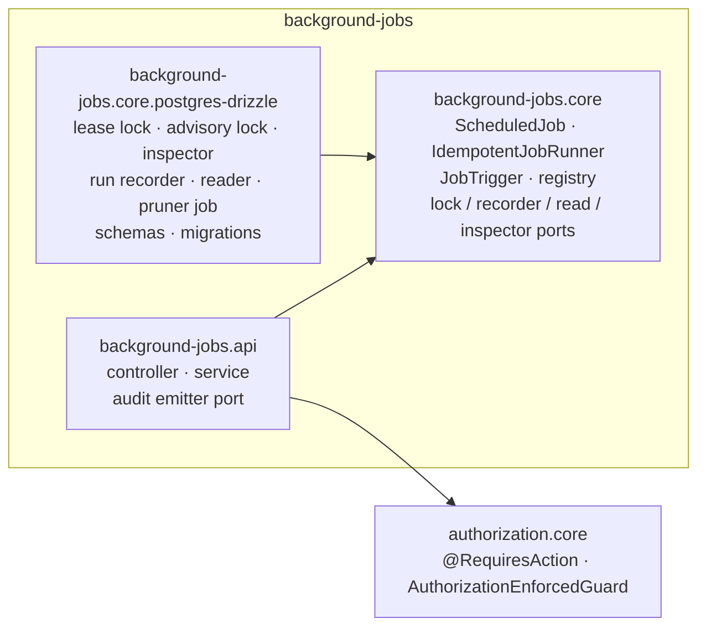
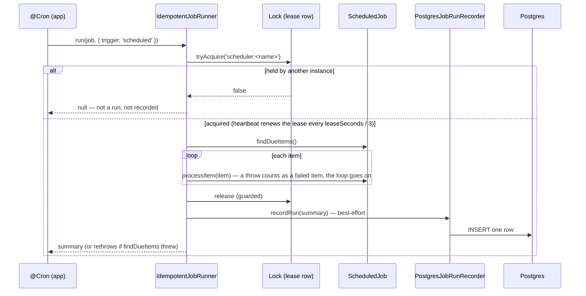

# Background Jobs — Developer Guide

**For:** a developer new to `background-jobs` — to understand how it works end to end, change it safely, and build the
next module the same way. **Covers:** the three packages (NestJS), how a consuming app wires them and schedules its
jobs, the run (write) path, Run now, the read path and the dashboard's derived health, the Lock Inspector, security,
data, testing, how-tos, and the 2026-10 review.
**Companion docs:** [`README.md`](./README.md) (what the module is, how to consume it) ·
[`AUDIT-REPORT.md`](./AUDIT-REPORT.md) (review verdict and gaps) ·
[`../MODULE-GUIDE-TEMPLATE.md`](../MODULE-GUIDE-TEMPLATE.md) (what every module's guide covers).

Code excerpts are trimmed (`// …`) but otherwise exactly what's in the files named above them. Paths are relative to
`ascendra-commons/background-jobs/` unless they start with a repo name.

---

## Contents

1. [What it does, in one minute](#1-what-it-does-in-one-minute)
2. [The packages and what depends on what](#2-the-packages-and-what-depends-on-what)
3. [NestJS building blocks used here](#3-nestjs-building-blocks-used-here)
4. [Wiring it into an app](#4-wiring-it-into-an-app)
5. [The run path — how a scheduled fire becomes a run row](#5-the-run-path--how-a-scheduled-fire-becomes-a-run-row)
6. [Run now — starting a job from a screen](#6-run-now--starting-a-job-from-a-screen)
7. [The read path, and the dashboard's derived health](#7-the-read-path-and-the-dashboards-derived-health)
8. [Every endpoint](#8-every-endpoint)
9. [Security model](#9-security-model)
10. [Data model, indexes and migrations](#10-data-model-indexes-and-migrations)
11. [Testing](#11-testing)
12. [How to change things](#12-how-to-change-things)
13. [Review (2026-10)](#13-review-2026-10)
14. [File map](#14-file-map)

---

## 1. What it does, in one minute

Something must run unattended — send invoice reminders hourly, sweep payouts, prune old rows — **once per due item,
never twice at once, and without one bad item stalling the rest**. A job says only *what is due* and *how to process
one item*; `IdempotentJobRunner` does the rest: take a cross-instance lock, iterate the items with per-item failure
isolation, release, and record one **run** summary. The module ships no scheduler — the app wraps each job in its own
`@Cron`. On top, a read API turns the run history into a health dashboard: which jobs are failing, overdue, or held by a
process that died.

| Term | Meaning |
|---|---|
| **Job** | A `ScheduledJob<TItem>`: `name` (unique — also its lock key), `findDueItems()`, `processItem()`, optional `describeItem()`. |
| **Run** | One `run()` that took the lock — one row in `commons_jobs_job_run`. A fire that found the lock held is *not* a run and isn't recorded. |
| **Trigger** | Why it ran: `scheduled` (its `@Cron`), `bootstrap` (a catch-up at startup), `manual` (Run now). |
| **Outcome** | `completed` (even with failed items) or `job_failed` (`findDueItems()` threw — nothing processed). |
| **Failed item** | An item whose `processItem()` threw. It stays due and retries next run; its `describeItem()` label is kept (≤ 50 per run). |
| **Chronic offender** | An item label that failed in ≥ 2 of a job's last 50 runs — `GET /jobs/:name/failed-items`. |
| **Cadence** | "If it hasn't run in this long, something's wrong" — declared per job (`'1h'`), or inferred from the median gap of its scheduled runs. Not its cron. |
| **Overdue** | The last run started more than 1.5 × the cadence ago, or a declared job has never run. |
| **Needs attention** | Overdue, or failing 2+ runs in a row (`job_failed` or any failed item). |
| **Lock** | The cross-instance mutex, key `scheduler:<job name>`. `PostgresLeaseLock` (a row with a lease) or `PostgresAdvisoryLock` (session-level). |
| **Expired lock** | A lease row past `locked_until`: its holder died mid-run. The next run takes it over. |
| **Correlation id** | A manual run's trace id — the screen follows the run by it, and it joins the run to the request's audit record. |
| **Application** | Which Ascendra app recorded the row. Stamped on write, scoped on every read. |

---

## 2. The packages and what depends on what



| Package | Ships | Never depends on |
|---|---|---|
| `background-jobs.core` | `ScheduledJob`, `IdempotentJobRunner`, `JobTrigger`, `ScheduledJobRegistry`, `BackgroundJobsModule`; the `AdvisoryLock`, `JobRunRecorder` (+ `NoopJobRunRecorder`), `JobObservabilityPort` and `JobLockInspectorPort` ports and DTOs; `parseCadence`, the keyset cursor, calendar days | a database, HTTP, a scheduler |
| `background-jobs.core.postgres-drizzle` | `PostgresLeaseLock`, `PostgresAdvisoryLock`, `PostgresLeaseLockInspector`, `PostgresJobRunRecorder`, `PostgresJobObservabilityService`, `JobRunPrunerJob`, a module each, the Drizzle tables, numbered migrations | HTTP, authorization |
| `background-jobs.api` | `JobsController`, `JobsApiService`, `JobsApiModule`, `JOB_ACTIONS`, the `JobAuditEmitter` port (+ no-op) | a stack adapter — it reads through the ports; `audit-logging` (audit is a port the app binds) |

`.core` ships **no lock implementation** — `forRoot()` requires the app to pick one. `scripts/check.js` enforces the
boundaries.

---

## 3. NestJS building blocks used here

### 3.1 Dynamic modules — the lock is required, the recorder optional

```ts
// background-jobs.core/background-jobs.module.ts
if (!config?.advisoryLockToken) {
  throw new Error('BackgroundJobsModule.forRoot() requires advisoryLockToken — POSTGRES_ADVISORY_LOCK or ' + /* … */);
}
const recorderProvider: Provider = config.jobRunRecorderToken
  ? { provide: JOB_RUN_RECORDER, useExisting: config.jobRunRecorderToken }
  : { provide: JOB_RUN_RECORDER, useClass: NoopJobRunRecorder };
// …
providers: [
  { provide: ADVISORY_LOCK, useExisting: config.advisoryLockToken },
  recorderProvider,
  IdempotentJobRunner,
  registryProvider,
  JobTrigger,
],
exports: [IdempotentJobRunner, JobTrigger, ScheduledJobRegistry],
```

### 3.2 A factory provider — jobs resolvable by name

`@Cron` wiring holds job instances; an HTTP request holds a string. The registry is built from the `jobs` the app lists,
each injected by its class:

```ts
// background-jobs.core/background-jobs.module.ts
const registryProvider: Provider = {
  provide: ScheduledJobRegistry,
  useFactory: (...jobs: ScheduledJob<unknown>[]) => new ScheduledJobRegistry(jobs),
  inject: config.jobs ?? [],
};
```

Two jobs with one name is a startup error (they'd share a lock key without knowing it).

### 3.3 Injection tokens — symbols; optional ones with `@Optional()`

```ts
// background-jobs.api/jobs-api.service.ts
constructor(
  @Inject(JOB_OBSERVABILITY_PORT) private readonly observability: JobObservabilityPort,
  @Inject(JobTrigger) private readonly jobTrigger: JobTrigger,
  @Inject(JOB_AUDIT_EMITTER) private readonly audit: JobAuditEmitter,
  @Optional() @Inject(JOB_LOCK_INSPECTOR_PORT) private readonly lockInspector?: JobLockInspectorPort,
  @Optional() @Inject(JOB_CORRELATION_ID_RESOLVER) private readonly correlationIdResolver?: () => string | undefined,
) {}
```

Every constructor parameter has an explicit `@Inject` — this library's build doesn't emit `design:paramtypes`.

### 3.4 Lifecycle hooks — the lease heartbeat

```ts
// background-jobs.core.postgres-drizzle/lock/postgres-lease-lock.ts
onModuleDestroy(): void {
  for (const timer of this.heartbeats.values()) clearInterval(timer);
  this.heartbeats.clear();
}
```

The app's schedule class uses `OnApplicationBootstrap` for catch-up runs (§4).

### 3.5 Guards, decorators and a status code on the API

```ts
// background-jobs.api/jobs.controller.ts
@Controller('jobs')
@UseGuards(AuthorizationEnforcedGuard)
export class JobsController {
  // …
  @Post(':name/run')
  @HttpCode(202)
  @RequiresAction(JOB_ACTIONS.RUN)
  run(@CurrentActor() actor: Actor, @Param('name') name: string, @Headers('x-correlation-id') correlationId?: string) {
    return this.service.trigger(actor, name, correlationId);
  }
```

Route order matters: the static `runs/summary` and `runs/volume` are declared before `runs/:id`.

---

## 4. Wiring it into an app

The sandbox is the reference consumer:

```ts
// ascendra-commons-sandbox/src/modules/commons/background-jobs.ts (trimmed)
export const backgroundJobs = BackgroundJobsModule.forRoot({
  advisoryLockToken: POSTGRES_LEASE_LOCK,
  jobRunRecorderToken: POSTGRES_JOB_RUN_RECORDER,
  jobs: [...DEMO_JOBS, JobRunPrunerJob, RateLimitRetentionJob, DomainEventRetentionJob, IdempotencyCleanupJob],
  imports: [
    PostgresLeaseLockModule.forRoot({ sqlExecutorToken: DATABASE_CONNECTION, application, imports: [DatabaseModule] }),
    PostgresJobRunRecorderModule.forRoot({ sqlExecutorToken: DATABASE_CONNECTION, application, imports: [DatabaseModule] }),
    DemoJobsModule, jobRunPruner, RateLimitRetentionModule, DomainEventRetentionModule, IdempotencyCleanupModule,
  ],
});

export const backgroundJobsApi = JobsApiModule.forRoot({
  auditEmitterToken: AuditJobEmitter,            // job · triggered, through domain-events into audit-logging
  correlationIdResolver: getCurrentCorrelationId, // audit-logging's — a Run now traces with its request
  imports: [
    PostgresJobObservabilityModule.forRoot({ sqlExecutorToken: DATABASE_CONNECTION, application, cadences: JOB_CADENCES, imports: [DatabaseModule] }),
    PostgresLeaseLockInspectorModule.forRoot({ sqlExecutorToken: DATABASE_CONNECTION, application, imports: [DatabaseModule] }),
    backgroundJobs,
    AuditJobEmitterModule,
  ],
});

// The schedule — the app's part: a thin @Cron per job around the shared runner.
@Injectable()
class JobSchedules implements OnApplicationBootstrap {
  onApplicationBootstrap() {
    for (const job of [this.jobRunPruner, this.rateLimitRetention, this.domainEventRetention, this.idempotencyCleanup]) {
      void this.run(job, 'bootstrap');
    }
  }
  @Cron(CronExpression.EVERY_HOUR) invoiceRemindersRun() { return this.run(this.invoiceReminders); }
  // …
  private async run(job: ScheduledJob<unknown>, trigger: JobRunTrigger = 'scheduled') {
    try {
      await this.runner.run(job, { trigger });
    } catch (err) {
      this.logger.warn(`Job "${job.name}" failed: ${err instanceof Error ? err.message : String(err)}`);
    }
  }
}
```

The other modules' retention tasks (rate-limiting, domain-events, idempotency) are `ScheduledJob`s here too — so their
prunes show on the dashboard, take the lock, and can be run now.

**Checklist**

1. `node ascendra-commons.js add background-jobs/background-jobs.core.postgres-drizzle background-jobs/background-jobs.api`;
   install `@nestjs/schedule`, `ScheduleModule.forRoot()`.
2. **Pick a lock.** `PostgresLeaseLock` works through any pooler and is listable (the Lock Inspector needs it);
   `PostgresAdvisoryLock` needs a dedicated single connection, never a transaction-mode pooler (README table).
3. Apply the migrations (`0001`–`0004`; `0002` only matters for the lease lock).
4. Write each job: `findDueItems()` returns what is *still* due (level-triggered), `processItem()` does the side effect
   and writes its "done" marker **last**, `describeItem()` returns an id — never PII, never the row. Keep job names in
   one const catalog.
5. `BackgroundJobsModule.forRoot({ advisoryLockToken, jobRunRecorderToken, jobs, imports })` — `jobs` lists the ones an
   admin may run now.
6. A schedule class: a `@Cron` per job calling `runner.run(job, { trigger })`, catching a `job_failed` rejection.
7. Optional read API: `JobsApiModule.forRoot({ imports: [PostgresJobObservabilityModule.forRoot({ cadences }), PostgresLeaseLockInspectorModule.forRoot(…), <the BackgroundJobsModule>] })`;
   grant `job.view` to platform personas, `job.run` to admins only. Bind `auditEmitterToken` and
   `correlationIdResolver` so a Run now is audited and traceable.
8. Declare a cadence for every scheduled job (`cadences`) — an undeclared one is inferred only after 3 scheduled runs.
9. Retention: wire `JobRunPrunerModule.forRoot({ retentionDays })` and schedule `JobRunPrunerJob` like any job.

---

## 5. The run path — how a scheduled fire becomes a run row



**The runner** isolates each item, and always releases and records — even when `findDueItems()` threw:

```ts
// background-jobs.core/idempotent-job-runner.service.ts
const acquired = await this.lock.tryAcquire(lockKey);
if (!acquired) return null; // another instance already owns this job — … Not a run; not recorded.
this.announceStart(job, options);
// …
try {
  const due = await job.findDueItems();
  itemsDue = due.length;
  for (let i = 0; i < due.length; i++) {
    try {
      await job.processItem(due[i]);
      itemsProcessed++;
    } catch (err) {
      itemsFailed++;
      const ref = this.describe(job, due[i], i, due.length);
      if (failedItemRefs.length < MAX_FAILED_ITEM_REFS) failedItemRefs.push(ref);
      // … logged; it stays due and retries next run
    }
  }
} catch (err) {
  outcome = 'job_failed';
  jobError = err instanceof Error ? (err.stack ?? err.message) : String(err);
  throw err;
} finally {
  await this.lock.release(lockKey).catch(/* logged — never masks the primary error */);
  summary = { jobName: job.name, trigger: options?.trigger ?? 'scheduled', startedAt, finishedAt: new Date(), outcome, /* … */ };
  await this.record(summary);
}
```

**The lease lock** takes a free key, or one whose lease lapsed — atomically, so two instances racing an expired lock
can't both win:

```ts
// background-jobs.core.postgres-drizzle/lock/postgres-lease-lock.ts
insert into commons_jobs_lock (application, lock_key, holder, acquired_at, locked_until)
values (${this.application}, ${key}, ${this.holder}, now(), now() + (${this.leaseSeconds} * interval '1 second'))
on conflict (application, lock_key) do update
  set holder = excluded.holder, acquired_at = now(), locked_until = excluded.locked_until
  where commons_jobs_lock.locked_until < now()
returning holder
```

**The recorder** writes one row per run — runs are rare and off every request path, so there's no buffer (contrast
domain-events). It normalizes each summary first, because its best-effort contract would otherwise swallow a failed
`INSERT` and the run would vanish:

```ts
// background-jobs.core.postgres-drizzle/run-recorder/postgres-job-run-recorder.ts
const refs = (Array.isArray(summary.failedItemRefs) ? summary.failedItemRefs : [])
  .slice(0, MAX_FAILED_ITEM_REFS)
  .map((ref) => text(ref, MAX_REF_LENGTH));               // NULs stripped, ≤ 500 chars each
const error = summary.error == null || summary.error === '' ? null : text(summary.error, MAX_ERROR_LENGTH); // ≤ 16,000
const correlationId = summary.correlationId && CORRELATION_ID.test(summary.correlationId) ? summary.correlationId : null;
```

### Failure semantics — read this before you rely on it

- **One item's failure never stops the batch.** It stays due (its "done" marker was never written) and retries next run
  — forever, if it always fails: there is no backoff or dead letter (the chronic-offender view shows it).
- **`job_failed` rejects `run()`** after it's recorded — the schedule class must catch it, or `@nestjs/schedule` logs an
  unhandled error.
- **A process that dies mid-run records nothing.** The summary is written after the run. The lease row stays until it
  expires (`leaseSeconds`, default 900) — that's the only trace, on the Locks screen as **expired** — and the next run
  takes it over. With the advisory lock there's no trace at all.
- **A lease can lapse under a live run** if the heartbeat can't reach the database for a whole lease: another instance
  may then run the job concurrently. The heartbeat logs a WARN. Per-item idempotency (step 4 of §4) is what keeps that
  safe.
- **Recording is best-effort.** A failed `INSERT` is logged and swallowed — the job's outcome never depends on it.

---

## 6. Run now — starting a job from a screen

A job can run longer than a proxy's timeout, so `POST /jobs/:name/run` **answers once the job has its lock** — never
after the run — and the screen follows the run by its correlation id:

```mermaid
sequenceDiagram
  participant UI as Job screen
  participant API as JobsApiService
  participant T as JobTrigger.start
  participant R as IdempotentJobRunner
  UI->>API: POST /jobs/payout-sweep/run
  API->>T: start(name, correlationId)
  T->>R: run(job, { trigger: 'manual', correlationId, onStarted })
  R-->>T: onStarted() — the lock is taken
  T-->>API: { status: 'started' }
  API-->>UI: 202 { status: 'started', correlationId }
  Note over R: the run goes on; its row is written when it finishes
  loop every 2s, up to 10 min
    UI->>API: GET /jobs/runs/trace/:correlationId
  end
  Note over UI: one toast: "running…" → the result (stays until closed)
```

```ts
// background-jobs.core/job-trigger.ts
start(jobName: string, correlationId?: string): Promise<JobStartResult> {
  const job = this.registry.get(jobName);
  if (!job) return Promise.resolve({ status: 'unknown_job' });
  return new Promise((resolve, reject) => {
    let started = false;
    this.runner
      .run(job, { trigger: 'manual', correlationId, onStarted: () => { started = true; resolve({ status: 'started' }); } })
      .then((summary) => { if (!summary) resolve({ status: 'already_running' }); })
      .catch((err) => {
        if (!started) return reject(err); // the lock couldn't be asked for — the caller's error
        this.logger.warn(/* … started by hand, failed — recorded as job_failed */);
      });
  });
}
```

The service picks the correlation id (a well-formed `X-Correlation-Id`, else the app's ambient id, else a fresh UUID),
audits every attempt — refused ones included — and maps refusals to 404 / 409:

```ts
// background-jobs.api/jobs-api.service.ts
const correlationId = wellFormed(headerCorrelationId) ? headerCorrelationId : (this.ambientCorrelationId() ?? randomUUID());
const result = await this.jobTrigger.start(jobName, correlationId);
await this.audit.record({ action: 'job.triggered', actorId: actor.id, jobName, result: result.status });
if (result.status === 'unknown_job') throw new NotFoundException(/* … */);
if (result.status === 'already_running') throw new ConflictException(/* … */);
return { status: 'started', correlationId };
```

A double-click is a 409 — the lock is the guard. `JobTrigger.trigger()` (awaits the whole run) stays for scripts and
tests.

---

## 7. The read path, and the dashboard's derived health

`GET /jobs/runs?hasFailedItems=true&since=…` from a tile on the Overview:

1. **Guards** — the auth guard sets `request.actor`; `AuthorizationGuard` (`job.view` or 403); the controller's
   `AuthorizationEnforcedGuard` (500 if the global guard is missing).
2. **Controller** — query strings in, Rule 4's cursor shape out (`{ data, meta: { nextCursor } }`).
3. **Service** — a bad date, limit, outcome, trigger, boolean, order, time zone or cursor, or a NUL byte, is a 400.
4. **Reader** — one dynamic `SELECT` on `started_at`, keyset on `(started_at, id)` led by the indexed column, the cursor
   at the column's microsecond precision:

```ts
// background-jobs.core.postgres-drizzle/observability/postgres-job-observability.service.ts
const STARTED_AT_KEY = sql`to_char(started_at at time zone 'UTC', 'YYYY-MM-DD"T"HH24:MI:SS.US"Z"') as started_at_key`;
// …
conds.push(
  asc
    ? sql`started_at >= ${ts} and (started_at > ${ts} or id > ${id})`
    : sql`started_at <= ${ts} and (started_at < ${ts} or id < ${id})`,
);
```

**The dashboard** (`GET /jobs`) reads each job's latest 50 runs — the distinct job names by a recursive skip scan over
the job index, then a `lateral` per name — and derives health in code:

```ts
// background-jobs.core.postgres-drizzle/observability/postgres-job-observability.service.ts
let consecutiveFailures = 0;
for (const run of runs) {
  if (run.outcome === 'job_failed' || run.itemsFailed > 0) consecutiveFailures++;
  else break;
}
const cadence = this.cadenceFor(name, runs);   // declared, else the median gap of ≥ 3 scheduled runs
if (cadence && lastRun) {
  const gapSeconds = (now - lastRun.startedAt.getTime()) / 1000;
  if (gapSeconds > cadence.seconds * OVERDUE_FACTOR) { overdue = true; /* … */ }
} else if (cadence && !lastRun) {
  overdue = true;                               // declared, never ran
}
```

The API adds every job registered for Run now that never ran, and a `triggerable` flag. **Needs attention** is the same
rule as `GET /jobs/alerts`, computed in the browser (`needsAttention()` in `background-jobs.ui/display.ts`) so the tile,
its panel and the Job screen agree without a second read.

**The Lock Inspector** (`GET /jobs/locks`) lists the lease rows; `state` comes from the database's clock — the same
clock `tryAcquire` takes over by:

```ts
// background-jobs.core.postgres-drizzle/lock/postgres-lease-lock-inspector.ts
select lock_key, holder, acquired_at, locked_until, locked_until < now() as expired
from commons_jobs_lock
where application = ${this.application}
order by acquired_at, lock_key
```

**The screens** (`ascendra-commons-ui`): **Overview** (24 h / 7 d / 30 d; tiles Runs, With failed items, Job failures —
each opening Runs on exactly what it counted — and Needs attention; the Needs attention and Jobs lists), **Runs**
(Recent / Advanced Filter, the run sheet with the full stack, the trace sheet), **Job** (its health, chronic failed
items, recent runs, Run now), **Locks**, **Volume & Retention** (runs per day stacked by outcome, each day a link).

---

## 8. Every endpoint

All `job.view` except Run now (`job.run`). No tenant scoping (§9). Every period is on `startedAt`.

| Endpoint | Port call | Notes |
|---|---|---|
| `GET /jobs` | `listJobStatus` + `JobTrigger.availableJobs` | One row per job: last run, last clean run, consecutive failures, cadence (declared / inferred), overdue, `triggerable`. Bare array. |
| `GET /jobs/alerts` | the above, filtered | Overdue, or 2+ consecutive failures. Read-only — no ack, no notification. |
| `GET /jobs/locks` | `JobLockInspectorPort.listLocks` | `{ supported, locks }` — `held` / `expired`. `supported: false` on the advisory lock. |
| `GET /jobs/runs` | `getRunHistory` | Filters `jobName`, `outcome`, `trigger`, `hasFailedItems`, `correlationId`, `since` / `until`; `limit` (default 50, ≤ 200), `cursor`, `order` (`desc`). `{ data, meta: { nextCursor } }`; `error` truncated to 500 chars. |
| `GET /jobs/runs/summary` | `runSummary` | `since` → runs, clean, with failed items, job failed, manual, items processed / failed, distinct jobs. |
| `GET /jobs/runs/volume` | `volume` | `tz` (IANA, default UTC; unknown → 400) → 30 zero-filled days (runs, with failed items, job failed); oldest run, row count, table size. |
| `GET /jobs/runs/trace/:correlationId` | `getRunHistory` (asc) | A Run now's run(s), oldest first. Same shape. An unknown id is an empty page. |
| `GET /jobs/runs/:id` | `getRun` | Full, untruncated `error`. A non-numeric or missing id → 404. |
| `GET /jobs/:name/failed-items` | `getFailedItems` | Labels failing in ≥ `minRuns` (default 2) of the last 50 runs. An unknown job → 404. |
| `POST /jobs/:name/run` | `JobTrigger.start` | 202 `{ status: 'started', correlationId }` once the lock is taken; 404 unknown / not registered; 409 already running. Audited. |

---

## 9. Security model

| Concern | Where it's decided | Behaviour |
|---|---|---|
| **Who you are** | The consumer's auth guard | No / bad token → 401. |
| **May you read / run** | `AuthorizationGuard` + `@RequiresAction('job.view' / 'job.run')`, `AuthorizationEnforcedGuard` | Missing action → 403; a missing global guard → 500 naming the fix. The sandbox: admin view + run, support view only. |
| **Whose data** | — | No tenant scope: a run belongs to the app, not a tenant. Per-item tenancy lives inside a job. Grant to platform personas only. |
| **Which application** | Reader, recorder, inspector, pruner, lease lock | `application = $1` from config everywhere. `tableSizeBytes` is the whole table. |
| **What's stored** | `PostgresJobRunRecorder` | Counts, times, outcome, ≤ 50 `describeItem()` labels (≤ 500 chars), a job failure's stack (≤ 16,000), a correlation id only if 1–128 of `[A-Za-z0-9._:-]`. Labels and stacks are the job author's text — `describeItem()` must not return PII. |
| **Stack traces** | Reader | List rows truncate `error` to 500 chars; the full stack only via `GET /jobs/runs/:id` (same `job.view`). |
| **Run now** | `job.run`, the lock, the audit port | Only registered jobs; a second press is a 409; every attempt audited with its result. Nothing a caller sends reaches the job. |
| **Injection** | Every SQL value is a bound parameter — the time zone, cursor parts and `failed_item_refs` elements included. | — |
| **Bad input** | Service + reader | Bad date / number / enum / zone / cursor, NUL → 400; missing run / unknown job → 404. No 500 for a caller's mistake (§13 probes). |
| **Inbound header** | Service, recorder | A malformed `X-Correlation-Id` is replaced by the ambient or a fresh id — never stored. |

---

## 10. Data model, indexes and migrations

```sql
-- after migrations 0001–0004 (run-recorder/job-run.schema.ts, lock/lease-lock.schema.ts mirror them)
"commons_jobs_job_run" (
  "id"               bigserial   PRIMARY KEY,
  "application"      text        NOT NULL,
  "job_name"         text        NOT NULL,
  "trigger"          text        NOT NULL,   -- 'scheduled' | 'bootstrap' | 'manual'
  "started_at"       timestamptz NOT NULL,   -- every read is on it
  "finished_at"      timestamptz NOT NULL,
  "outcome"          text        NOT NULL,   -- 'completed' | 'job_failed'
  "items_due"        integer     NOT NULL,
  "items_processed"  integer     NOT NULL,
  "items_failed"     integer     NOT NULL,
  "failed_item_refs" text[]      NOT NULL DEFAULT '{}',
  "error"            text,
  "correlation_id"   text
)
"commons_jobs_lock" (
  "application" text, "lock_key" text, "holder" text, "acquired_at" timestamptz, "locked_until" timestamptz,
  PRIMARY KEY ("application", "lock_key")
)
```

Checked with `EXPLAIN` on the sandbox (`enable_seqscan = off`, 15,941 runs):

| Index | Serves |
|---|---|
| `…_list_idx` `(application, started_at desc, id desc)` | Runs newest-first and every page (Index Cond `started_at <=`), the summary, the volume (index-only), the pruner (index-only). |
| `…_job_idx` `(application, job_name, started_at desc, id desc)` | One job's runs; the dashboard's skip scan and latest 50 per job; the failed-items window. |
| `…_failing_idx` partial `where outcome = 'job_failed' or items_failed > 0` | Runs filtered to failures (the With failed items / Job failures tiles). |
| `…_manual_idx` partial `where trigger = 'manual'` | Runs filtered to Run now runs. |
| `…_correlation_idx` partial `where correlation_id is not null` | A trace; the correlation filter. |
| `commons_jobs_lock` primary key | The Lock Inspector; `tryAcquire`'s conflict target. |

| Migration | What |
|---|---|
| `0001_job_run.sql` | The run table; one `(application, job_name, started_at)` index. |
| `0002_lease_lock.sql` | The lease table (harmless if you use the advisory lock). |
| `0003_job_run_read_indexes.sql` | list, job (replaces 0001's), failing, correlation. |
| `0004_job_run_manual_index.sql` | manual. |

Build an index with `CREATE INDEX CONCURRENTLY` first on a large table — a plain one blocks the recorder.

---

## 11. Testing

```
npx vitest run background-jobs      # from the ascendra-commons root — 19 files, 151 tests
npx tsc --noEmit -p .
node scripts/check.js
```

The runner and trigger are tested against a fake lock and recorder; the Postgres adapters against a fake `SqlExecutor`
that records the Drizzle `SQL`, rendered with `PgDialect`; the API module boots with Nest's testing module to check
routing and guards.

```ts
// background-jobs.core/job-trigger.spec.ts
it('resolves started before findDueItems resolves, and the run goes on to be recorded', async () => {
  let release!: (items: number[]) => void;
  const findDueItems = vi.fn(() => new Promise<number[]>((r) => (release = r)));
  const recordRun = vi.fn().mockResolvedValue(undefined);
  const runner = new IdempotentJobRunner(lock(true), { recordRun });
  // …
  const result = await new JobTrigger(new ScheduledJobRegistry([job]), runner).start('slow', 'trace-1');

  expect(result).toEqual({ status: 'started' });
  expect(recordRun).not.toHaveBeenCalled(); // still running
  release([1, 2]);
  await vi.waitFor(() =>
    expect(recordRun).toHaveBeenCalledWith(
      expect.objectContaining({ trigger: 'manual', correlationId: 'trace-1', outcome: 'completed', itemsProcessed: 2 }),
    ),
  );
});
```

**Not covered by specs:** SQL against a real Postgres — the lease upsert's race, the skip scan, time-zone bucketing and
the plans were verified against the sandbox's Postgres 16 (§13).

---

## 12. How to change things

### Add a filter to the runs list
`RunHistoryQuery` → the reader's `conds` (an index if a screen uses it — `EXPLAIN` with `enable_seqscan = off` first; a
rare value wants a partial index, as `manual` did) → `RunHistoryQueryDto`, the controller's `@Query`, the service
(validated) → specs → the API README → the UI's query defs.

### Change what counts as "needs attention"
The API's `ALERT_CONSECUTIVE_FAILURES_THRESHOLD` and `OVERDUE_FACTOR` in the reader — and the UI's `needsAttention()`,
which must stay the same rule.

### Add a job
A `ScheduledJob` provider, a `@Cron` in the app's schedule class, a cadence in `cadences`, and — if an admin may run
it — an entry in `forRoot({ jobs })`.

### Change the table
The next numbered migration + the schema + the recorder's `INSERT` column list + `mapRowBase`. Breaking for the API?
`!` and a `BREAKING CHANGE:` footer.

### Ship a change to the sandbox
```
node ascendra-commons.js update --yes --from ../ascendra-commons
npm run db:migrate && npx nest build       # restart dist/main, probe with curl as a dev user
```

---

## 13. Review (2026-10)

**Fixed**

| Before | After | Commit |
|---|---|---|
| A NUL byte in an error or label, an unbounded stack, an Invalid Date or a bad count failed the `INSERT` — and the best-effort contract swallowed it: the run vanished | Each summary normalized before it's bound | `b02824e` |
| The pruner deleted everything older than the cutoff in one statement — one long lock on the table the recorder writes | Batches of 5,000 | `fb01962` |
| The dashboard's `row_number()` read the whole history per load; one job's runs only (no list across jobs); no index for the unfiltered list, failures or a trace; cursor at JS millisecond precision; a garbage cursor restarted silently; bad dates, a non-numeric run id → 500; no `AuthorizationEnforcedGuard`; unknown job / already running → 200 | Skip scan + per-job index reads; `GET /jobs/runs` across jobs; migration 0003; microsecond JSON cursor; summary and volume; Rule 4; every bad param a 400, missing run a 404, refusals 404 / 409 (**breaking**) | `fc2e515` |
| No way to see a lock a dead process left | Lock Inspector — `GET /jobs/locks` | `fe9296b` |
| A Run now from a screen got a fresh correlation id, the request's audit record another — they never met in a trace | `correlationIdResolver` (header → ambient → fresh) | `f6a96d0` |
| `?trigger=manual` walked every run in the range | Partial `manual_idx`, migration 0004 | `7bdd6cf` |
| `GET /jobs/<unknown>/failed-items` → 200 `[]` — "nothing fails" and "no such job" read the same | 404 | `e2f21a2` |
| Run now awaited the whole run — a job longer than a proxy's timeout showed an error for a run that then finished, inviting a second press | 202 once the lock is taken; the screen follows the trace (**breaking**) | `aaffe5b` |

**Probed on the sandbox after the fixes** — none is a 500: `since=yesterday`, `until=2026-13-45`, `limit=abc|0`,
`limit=99999` (capped), a garbage cursor, `outcome=lost`, `trigger=cron`, `hasFailedItems=maybe`, `order=up`, NUL in a
job name, a trace id or a Run now name, `runs/abc` and `runs/99999999` (404), `tz=Mars/X`, `summary?since=nope`, an
unknown job's failed items (404), `minRuns=0`, a 5,000-character trace id (200, empty). Run now: 202 in 0.01 s for the
15-second `search-reindex`, 409 on the second press, 404 for an unknown job; a malformed `X-Correlation-Id` is replaced.
Support: `GET /jobs` 200, Run now 403; no token 401. Every screen read uses an index (§10). Every Overview number
equals its list's total (24 h / 7 d / 30 d, and a volume day).

**Open** — see [`AUDIT-REPORT.md`](./AUDIT-REPORT.md).

---

## 14. File map

```
background-jobs/
├── README.md · GUIDE.md · AUDIT-REPORT.md
├── background-jobs.core/
│   ├── scheduled-job.port.ts              what a job implements
│   ├── idempotent-job-runner.service.ts   lock → items with isolation → release → record
│   ├── job-trigger.ts                     run by name — start() (answers at the lock), trigger() (awaits)
│   ├── scheduled-job-registry.ts          name → job; duplicate names fail at startup
│   ├── advisory-lock.port.ts · job-run-recorder.port.ts · noop-job-run-recorder.ts
│   ├── job-observability.port.ts · job-observability.types.ts   reads + DTOs
│   ├── job-lock-inspector.port.ts         the Lock Inspector's read
│   ├── cadence.ts · keyset-cursor.ts · calendar-days.ts
│   └── background-jobs.module.ts · tokens.ts · index.ts
├── background-jobs.core.postgres-drizzle/
│   ├── lock/           lease lock (+ inspector) · advisory lock · modules · schema
│   ├── run-recorder/   one INSERT per run (+ module) · schema
│   ├── observability/  reader — list, dashboard, run, failed items, summary, volume (+ module)
│   ├── pruner/         JobRunPrunerJob (+ module)
│   ├── persistence/    SqlExecutor
│   └── migrations/     0001 runs · 0002 lease · 0003 read indexes · 0004 manual
└── background-jobs.api/
    ├── jobs.controller.ts · jobs-api.service.ts · jobs-api.module.ts · jobs-api.options.ts
    ├── job-audit.port.ts · dto/
    └── mocks.html
```

The UI lives in `ascendra-commons-ui`: `packages/background-jobs.ui/` (api client with `waitForRun()`, links, nav,
query defs, `display.ts`) and the screens in `testbed/app/observability/background-jobs/` (Overview, Runs + run and
trace sheets, Job with Run now, Locks, Volume & Retention).
