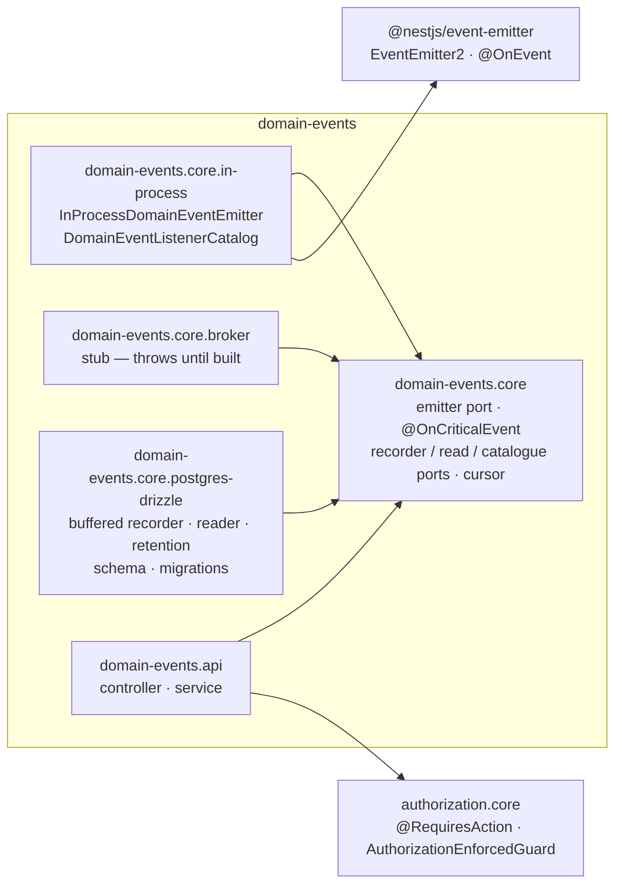
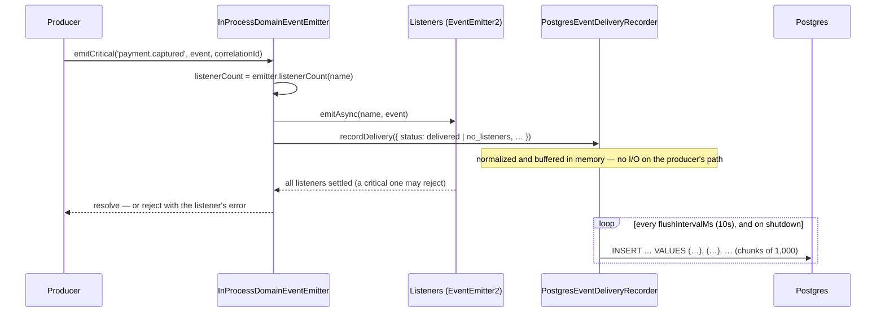

# Domain Events — Developer Guide

**For:** a developer new to `domain-events` — to understand how it works end to end, change it safely, and build the
next module the same way. **Covers:** the five packages (NestJS), how a consuming app wires them, the emit (write) and
read paths, the listener catalogue, security, data, testing, how-tos, and the 2026-10 review.
**Companion docs:** [`README.md`](./README.md) (what the module is, how to consume it) ·
[`AUDIT-REPORT.md`](./AUDIT-REPORT.md) (review verdict and gaps) ·
[`../MODULE-GUIDE-TEMPLATE.md`](../MODULE-GUIDE-TEMPLATE.md) (what every module's guide covers).

Code excerpts are trimmed (`// …`) but otherwise exactly what's in the files named above them. Paths are relative to
`ascendra-commons/domain-events/` unless they start with a repo name.

---

## Contents

1. [What it does, in one minute](#1-what-it-does-in-one-minute)
2. [The packages and what depends on what](#2-the-packages-and-what-depends-on-what)
3. [NestJS building blocks used here](#3-nestjs-building-blocks-used-here)
4. [Wiring it into an app](#4-wiring-it-into-an-app)
5. [The emit path — how an event becomes a delivery row](#5-the-emit-path--how-an-event-becomes-a-delivery-row)
6. [The read path, and the wiring join](#6-the-read-path-and-the-wiring-join)
7. [Every endpoint](#7-every-endpoint)
8. [Security model](#8-security-model)
9. [Data model, indexes and migrations](#9-data-model-indexes-and-migrations)
10. [Testing](#10-testing)
11. [How to change things](#11-how-to-change-things)
12. [Review (2026-10)](#12-review-2026-10)
13. [File map](#13-file-map)

---

## 1. What it does, in one minute

Business code never calls a notifier or an audit writer directly — it **raises an event** (`InvoiceSent`) and each
concern subscribes on its own. Two methods differ only in whether the producer hears about a failure: `emit()` is
fire-and-forget; `emitCritical()` awaits its `@OnCriticalEvent()` listeners and rejects if one fails, so the producer
can roll back. On top, a **delivery log** records every call — was anyone listening, did the hand-off happen — and a
**listener catalogue** reads which listeners the running app declares. Joined, they catch wiring bugs nothing else
shows.

| Term | Meaning |
|---|---|
| **Event** | A fact, named for what happened (`payment.captured`), with a JSON-serializable payload and an `occurredAt`. |
| **Delivery** | One `emit()` / `emitCritical()` call as the transport saw it — one row in `commons_domain_events_delivery`. Never the payload, never a listener's outcome. |
| **Critical** | Raised with `emitCritical()`, or a listener declared `@OnCriticalEvent()` (its failure must reach the producer). |
| **Status** | `delivered` (someone was subscribed), `no_listeners` (fired into nothing — a wiring gap), `dispatch_failed` (the transport itself broke — rare). A listener that throws is *not* a delivery failure. |
| **Listener catalogue** | Every `@OnEvent()` / `@OnCriticalEvent()` binding in this process, read from decorator metadata. |
| **Wiring check** | *critical listener, raised with `emit()`* · *fires into nothing* · *never fires* — the delivery catalog × the listener catalogue. |
| **Correlation id** | `emit()`'s optional third argument — one request or job's events, joinable with other modules' traces. |
| **Application** | Which Ascendra app recorded the row. Stamped by the recorder, scoped on every read. |

---

## 2. The packages and what depends on what



| Package | Ships | Never depends on |
|---|---|---|
| `domain-events.core` | `DomainEventEmitter` (emit / emitCritical), `OnCriticalEvent`, `assertDomainEventSerializable`, `DomainEventsModule`; the `EventDeliveryRecorder`, `EventDeliveryObservabilityPort` and `EventListenerCatalogPort` ports, the keyset cursor, calendar days | a database, HTTP |
| `domain-events.core.in-process` | `InProcessDomainEventEmitter` (Model 1) and its module; `DomainEventListenerCatalog` | a database |
| `domain-events.core.broker` | `BrokerDomainEventEmitter` — a stub that throws (Model 2's seam) | a database |
| `domain-events.core.postgres-drizzle` | `PostgresEventDeliveryRecorder` (buffered), `PostgresEventDeliveryObservabilityService`, `PostgresEventDeliveryRetentionService`, the Drizzle table, numbered migrations, three modules | HTTP, authorization, `@nestjs/event-emitter` |
| `domain-events.api` | `DomainEventsController`, `DomainEventsApiService`, `DomainEventsApiModule`, `DOMAIN_EVENTS_ACTIONS` | a stack adapter — it reads through the two ports |

`audit-logging` (and any module raising events) depends on `domain-events.core` only. `scripts/check.js` enforces the
boundaries.

---

## 3. NestJS building blocks used here

### 3.1 A thin decorator over `@OnEvent()` — `@OnCriticalEvent()`

`@OnEvent()` defaults to `suppressErrors: true`: NestJS catches and logs a listener's throw before it reaches
`emitCritical()`, silently defeating it. The critical variant only flips that flag:

```ts
// domain-events.core/on-critical-event.decorator.ts
type OnEventOptions = NonNullable<Parameters<typeof OnEvent>[1]>;

export function OnCriticalEvent(event: string, options?: Omit<OnEventOptions, 'suppressErrors'>) {
  return OnEvent(event, { ...options, suppressErrors: false });
}
```

### 3.2 Dynamic modules — the transport chosen by token

```ts
// domain-events.core/domain-events.module.ts
return {
  module: DomainEventsModule,
  imports: config.imports ?? [],
  providers: [{ provide: DOMAIN_EVENT_EMITTER, useExisting: config.emitterToken }],
  exports: [DOMAIN_EVENT_EMITTER],
};
```

The in-process module owns `EventEmitterModule.forRoot({ global: false })` — so nothing else can inject the raw
`EventEmitter2` and bypass the tiering — and exports the listener catalogue too:

```ts
// domain-events.core.in-process/in-process-domain-event-emitter.module.ts
return {
  module: InProcessDomainEventEmitterModule,
  imports: [EventEmitterModule.forRoot({ global: false }), DiscoveryModule, ...(config.imports ?? [])],
  providers: [
    recorderProvider,
    InProcessDomainEventEmitter,
    { provide: IN_PROCESS_DOMAIN_EVENT_EMITTER, useExisting: InProcessDomainEventEmitter },
    DomainEventListenerCatalog,
    { provide: EVENT_LISTENER_CATALOG_PORT, useExisting: DomainEventListenerCatalog },
  ],
  exports: [IN_PROCESS_DOMAIN_EVENT_EMITTER, EVENT_LISTENER_CATALOG_PORT],
};
```

### 3.3 Discovery — reading decorator metadata at runtime

`EventEmitter2.listeners()` returns NestJS's anonymous wrapper closures — no class, no method name. The catalogue reads
the metadata *before* that wrapping, off each provider's prototype, under `OnEvent`'s own public `KEY`:

```ts
// domain-events.core.in-process/domain-event-listener-catalog.service.ts
const EVENT_LISTENER_METADATA_KEY = (OnEvent('__domain_event_listener_catalog_probe__') as unknown as { KEY: string }).KEY;
// …
this.metadataScanner.scanFromPrototype(instance, prototype, (methodKey) => {
  const metadataList = this.reflector.get<OnEventMetadata[] | undefined>(EVENT_LISTENER_METADATA_KEY, instance[methodKey] as Function);
  if (!metadataList) return;
  for (const { event, options } of metadataList) {
    const critical = options?.suppressErrors === false;
    // … one entry per (event name, listener method)
  }
});
```

### 3.4 Injection tokens — symbols, bound with `useExisting` / `useValue`

```ts
// domain-events.core.postgres-drizzle/recorder/postgres-event-delivery-recorder.module.ts
providers: [
  { provide: EVENT_DELIVERY_SQL_EXECUTOR, useExisting: config.sqlExecutorToken },
  { provide: EVENT_DELIVERY_APPLICATION_ID, useValue: config.application },
  {
    provide: EVENT_DELIVERY_RECORDER_OPTIONS,
    useValue: { flushIntervalMs: config.flushIntervalMs, maxBufferedRows: config.maxBufferedRows },
  },
  PostgresEventDeliveryRecorder,
  { provide: POSTGRES_EVENT_DELIVERY_RECORDER, useExisting: PostgresEventDeliveryRecorder },
],
```

### 3.5 Lifecycle hooks — flush on shutdown

```ts
// domain-events.core.postgres-drizzle/recorder/postgres-event-delivery-recorder.ts
async onModuleDestroy(): Promise<void> {
  clearInterval(this.timer);
  await this.flush();
}
```

Runs on `SIGTERM` only when the app calls `app.enableShutdownHooks()`.

### 3.6 Guards and decorators on the read API

```ts
// domain-events.api/domain-events.controller.ts
@Controller('domain-events')
@UseGuards(AuthorizationEnforcedGuard)
export class DomainEventsController {
  // …
  @Get('deliveries/summary')
  @RequiresAction(DOMAIN_EVENTS_ACTIONS.VIEW)
  summary(@Query('since') since?: string) {
    return this.service.deliverySummary(since);
  }
```

---

## 4. Wiring it into an app

The sandbox is the reference consumer:

```ts
// ascendra-commons-sandbox/src/modules/commons/domain-events.ts (trimmed)
const inProcessEmitter = InProcessDomainEventEmitterModule.forRoot({
  recorderToken: POSTGRES_EVENT_DELIVERY_RECORDER,
  imports: [PostgresEventDeliveryRecorderModule.forRoot({ sqlExecutorToken: DATABASE_CONNECTION, application, imports: [DatabaseModule] })],
});

export const domainEvents = DomainEventsModule.forRoot({ emitterToken: IN_PROCESS_DOMAIN_EVENT_EMITTER, imports: [inProcessEmitter] });

export const domainEventsApi = DomainEventsApiModule.forRoot({
  imports: [
    PostgresEventDeliveryObservabilityModule.forRoot({ sqlExecutorToken: DATABASE_CONNECTION, application, imports: [DatabaseModule] }),
    inProcessEmitter, // the same instance — it provides EVENT_LISTENER_CATALOG_PORT
  ],
});
// … DomainEventRetentionTask: pruneDeliveries(90 days ago) at boot, then daily
```

**Checklist**

1. `node ascendra-commons.js add domain-events/domain-events.core.in-process domain-events/domain-events.core.postgres-drizzle domain-events/domain-events.api`; install `@nestjs/event-emitter`.
2. Apply the migrations (`0001`–`0002`).
3. `DomainEventsModule.forRoot({ emitterToken: IN_PROCESS_DOMAIN_EVENT_EMITTER, imports: [InProcessDomainEventEmitterModule.forRoot({ recorderToken, imports })] })`.
4. Event classes: one per fact, a `.spec.ts` calling `assertDomainEventSerializable()`. If an event has any
   `@OnCriticalEvent()` listener, **every** producer raises it with `emitCritical()` — the Wiring screen flags the ones
   that don't.
5. Pass the request / job's correlation id as `emit()`'s third argument, so its events trace.
6. Optional read API: `DomainEventsApiModule.forRoot({ imports: [PostgresEventDeliveryObservabilityModule.forRoot(…), <the same InProcessDomainEventEmitterModule instance>] })`;
   grant `domain-events.view` to a platform persona.
7. Retention: `PostgresEventDeliveryRetentionModule.forRoot(…)` and call `pruneDeliveries(cutoff)` from your scheduler.
8. `app.enableShutdownHooks()`, so the recorder's buffer is written on deploy.

---

## 5. The emit path — how an event becomes a delivery row



**The emitter** records the hand-off *before* waiting on listeners — a listener rejecting is not a delivery failure:

```ts
// domain-events.core.in-process/in-process-domain-event-emitter.service.ts
async emitCritical(eventName: string, event: DomainEvent, correlationId?: string): Promise<void> {
  const listenerCount = this.emitter.listenerCount(eventName);
  let dispatch: Promise<unknown[]>;
  try {
    dispatch = this.emitter.emitAsync(eventName, event);
  } catch (err) {
    // … the transport itself broke: record 'dispatch_failed', rethrow
  }
  await this.recordDelivery({
    eventName, method: 'emitCritical', transport: TRANSPORT, occurredAt: event.occurredAt, listenerCount,
    status: listenerCount === 0 ? 'no_listeners' : 'delivered', correlationId,
  });
  try {
    await dispatch;
  } catch (err) {
    this.logger.error(`emitCritical('${eventName}') — a critical listener failed. …`);
    throw err;
  }
}
```

**The recorder** normalizes each delivery as it buffers it — a malformed one (an `occurredAt` that went through JSON,
none at all, a NUL in an error message) must cost only itself, never the batch:

```ts
// domain-events.core.postgres-drizzle/recorder/postgres-event-delivery-recorder.ts
async recordDelivery(attempt: EventDeliveryAttempt): Promise<void> {
  if (this.buffer.length >= this.maxBufferedRows) {
    this.dropped += 1;
    return;
  }
  const deliveredAt = new Date();
  this.buffer.push({
    eventName: text(attempt.eventName, '(unnamed)'),
    method: attempt.method === 'emitCritical' ? 'emitCritical' : 'emit',
    occurredAt: occurredAtOf(attempt.occurredAt, deliveredAt),
    // … listenerCount coerced, reason NUL-stripped
    correlationId: attempt.correlationId && CORRELATION_ID.test(attempt.correlationId) ? attempt.correlationId : null,
  });
}
```

### Failure semantics — read this before you rely on it

- **The emit never depends on the log.** `recordDelivery()` is in memory; the emitter also guards the call.
- **A failed flush drops its rows** — logged with how many, never retried. A crash loses up to one interval (10 s). Past
  `maxBufferedRows` (10,000) in one interval, further deliveries are dropped and counted in the next flush's log.
- **Rows appear up to ~10 s late.**
- **`emit()` swallows every listener failure by design** (logged). Pair an `@OnCriticalEvent()` listener with `emit()`
  and its failure goes nowhere — the Wiring screen's red check.
- **A listener that throws is never `dispatch_failed`** — `emitAsync()` turns even a synchronous throw into a rejection.
  `dispatch_failed` means `emitAsync()` itself threw: genuinely rare.

---

## 6. The read path, and the wiring join

`GET /domain-events/deliveries?status=no_listeners&since=…&until=…` from a tile on the Overview:

1. **Guards** — the auth guard sets `request.actor`; `AuthorizationGuard` (`domain-events.view` or 403); the
   controller's `AuthorizationEnforcedGuard` (500 if the global guard is missing).
2. **Controller** — query strings in, Rule 4's cursor shape out (`{ data, meta: { nextCursor } }`).
3. **Service** — validation: a bad date, limit, method, status, order, time zone or cursor, or a NUL byte, is a 400:

```ts
// domain-events.api/domain-events-api.service.ts
return await this.deliveries.listDeliveries({
  eventName: textParam('eventName', query.eventName),
  method: enumParam('method', query.method, METHODS),
  status: enumParam('status', query.status, STATUSES),
  // … since / until (dateParam), limit (limitParam), cursor, order
});
```

4. **Reader** — one dynamic `SELECT`, every condition on `occurred_at`, keyset on `(occurred_at, id)` led by the indexed
   column so each page starts its scan at the boundary:

```ts
// domain-events.core.postgres-drizzle/observability/postgres-event-delivery-observability.service.ts
conds.push(
  asc
    ? sql`occurred_at >= ${cursor.timestamp} and (occurred_at > ${cursor.timestamp} or id > ${cursor.id})`
    : sql`occurred_at <= ${cursor.timestamp} and (occurred_at < ${cursor.timestamp} or id < ${cursor.id})`,
);
// … order by occurred_at ${dir}, id ${dir} limit ${limit + 1}
```

`occurred_at` is written from a JS `Date`, so the cursor's `Date` keeps its full precision (contrast idempotency's
`now()` column, §12 of its guide).

**The wiring join** happens in the browser (`ascendra-commons-ui`'s `domain-events.ui/wiring.ts`): the delivery
catalog over a period (`emitCount`, `emitCriticalCount`, …) against the listener catalogue (`critical` per binding):

```ts
// ascendra-commons-ui: packages/domain-events.ui/wiring.ts
const criticalViaEmit = !!entry && entry.emitCount > 0 && bound.some((l) => l.critical);
const firesIntoNothing = !!entry && bound.length === 0;
const neverFires = !entry && bound.length > 0;
```

---

## 7. Every endpoint

All under `@RequiresAction('domain-events.view')`. No tenant scoping (§8). Every period is on `occurredAt`.

| Endpoint | Port call | Notes |
|---|---|---|
| `GET /domain-events/deliveries` | `listDeliveries` | Filters `eventName`, `method`, `status`, `correlationId`, `since` / `until`; `limit` (default 50, ≤ 200), `cursor`, `order` (`desc`). `{ data, meta: { nextCursor } }`. |
| `GET /domain-events/deliveries/trace/:correlationId` | `listDeliveries` (asc) | One request / job's events, oldest first. Same shape. An unknown id is an empty page (200). |
| `GET /domain-events/deliveries/summary` | `deliverySummary` | `since` → total, delivered, no listeners, dispatch failed, critical, distinct event names. |
| `GET /domain-events/deliveries/catalog` | `deliveryCatalog` | `since` → per event: total, emit / emitCritical counts, no-listener / failed counts, last occurrence and its listener count. Bare array. |
| `GET /domain-events/deliveries/volume` | `volume` | `tz` (IANA, default UTC; unknown → 400) → 30 zero-filled days with problem counts; oldest delivery, row count, table size. |
| `GET /domain-events/listener-catalog` | `EventListenerCatalogPort.list` | Every `@OnEvent()` / `@OnCriticalEvent()` binding in this process. Recomputed per call (a provider scan). |

---

## 8. Security model

| Concern | Where it's decided | Behaviour |
|---|---|---|
| **Who you are** | The consumer's auth guard | No / bad token → 401. |
| **May you read the log** | `AuthorizationGuard` + `@RequiresAction('domain-events.view')`, `AuthorizationEnforcedGuard` | Missing action → 403 naming it; a missing global guard → 500 naming the fix. |
| **Whose data** | — | No tenant scope: a delivery has no tenant (the payload isn't stored) and the wiring is the whole app's. Grant to platform personas only (the sandbox: admin and support). |
| **Which application** | Reader, recorder, pruner | `application = $1` from config on every read and the prune. `tableSizeBytes` is the whole table. |
| **What's stored** | `PostgresEventDeliveryRecorder` | Name, method, transport, times, listener count, status, a failure's reason (NUL-stripped), the correlation id only if 1–128 of `[A-Za-z0-9._:-]`. **Never the payload** — no personal data. |
| **Injection** | Every SQL value is a bound parameter — the time zone and the cursor's parts included. | — |
| **Bad input** | Service + reader | Bad date / number / enum / zone / cursor, NUL → 400. No 500 for a caller's mistake (§12 probes). |
| **Write amplification** | The buffered recorder | One multi-row `INSERT` per 10 s per instance, whatever the event rate; bounded by `maxBufferedRows`. |
| **Information in the catalogue** | `DomainEventListenerCatalog` | Exposes class and method names of the app's listeners to `domain-events.view` holders — internal structure, so keep the action platform-only. |

---

## 9. Data model, indexes and migrations

```sql
-- after migrations 0001–0002 (persistence/domain-event-delivery.schema.ts mirrors it)
"commons_domain_events_delivery" (
  "id"             bigserial   PRIMARY KEY,
  "application"    text        NOT NULL,
  "event_name"     text        NOT NULL,
  "method"         text        NOT NULL,   -- 'emit' | 'emitCritical'
  "transport"      text        NOT NULL,   -- 'in-process'
  "occurred_at"    timestamptz NOT NULL,   -- the event's own time — every read is on it
  "delivered_at"   timestamptz NOT NULL,   -- when the recorder saw it
  "listener_count" integer     NOT NULL,
  "status"         text        NOT NULL,   -- 'delivered' | 'no_listeners' | 'dispatch_failed'
  "reason"         text,
  "correlation_id" text
)
```

Checked with `EXPLAIN` on the sandbox (`enable_seqscan = off`):

| Index | Serves |
|---|---|
| `…_list_idx` `(application, occurred_at desc, id desc)` | The log newest-first and every page (Index Cond `occurred_at <=`), the list filtered by method (plus a filter), the summary, the volume (index-only), the pruner (index-only). |
| `…_event_idx` `(application, event_name, occurred_at desc, id desc)` | The log filtered by event; the catalog's `group by event_name`. |
| `…_status_occurred_idx` `(application, status, occurred_at desc, id desc)` | The log filtered by status (the No listeners / Dispatch failed tiles). |
| `…_correlation_idx` `(correlation_id) where correlation_id is not null` | A trace; the log's correlation filter. |

| Migration | What |
|---|---|
| `0001_domain_event_delivery.sql` | The table; indexes on `delivered_at`. |
| `0002_domain_event_delivery_read_indexes.sql` | Every read moves to `occurred_at`: the four indexes above; 0001's two dropped. Build with `CREATE INDEX CONCURRENTLY` first on a large table. |

---

## 10. Testing

```
npx vitest run domain-events        # from the ascendra-commons root — 14 files, 110 tests
npx tsc --noEmit -p .
node scripts/check.js
```

The recorder and reader are tested without a database: a fake `SqlExecutor` records the Drizzle `SQL`, rendered with
`PgDialect`. The emitter runs against a real `EventEmitter2` with real `@OnEvent` / `@OnCriticalEvent` listeners; the
catalogue against a real `DiscoveryService`.

```ts
// domain-events.core.postgres-drizzle/recorder/postgres-event-delivery-recorder.spec.ts (trimmed)
it('a malformed delivery costs only itself — never the batch it lands in', async () => {
  // … good, a JSON string occurredAt, none, an Invalid Date, a NUL in the name and reason
  await r.flush();
  const { params } = rendered(db);
  expect(params).not.toContain(undefined);
  expect(params).toEqual(expect.arrayContaining(['good', 'json', 'none', 'invalid', 'nulname', 'boom']));
});
```

**Not covered by specs:** SQL against a real Postgres — the batched insert, the `array_agg` last-listener-count, the
time-zone bucketing and the plans were verified against the sandbox's Postgres 16 (§12).

---

## 11. How to change things

### Add a filter to the log
`DeliveryQuery` → the reader's `conds` (an index if a screen uses it — `EXPLAIN` first) → `DeliveryQueryDto`, the
controller's `@Query`, the service (validated) → specs → the API README → the UI's `domainEventsQueryDefs`.

### Add a wiring check
It belongs in the UI's `wiring.ts` if both reads already carry what it needs; otherwise add the count to
`deliveryCatalog` (one more `count(*) filter (…)`) or a field to `EventListenerCatalogEntry`.

### Change the table
The next numbered migration + the schema + the recorder's `INSERT` column list (the spec checks it against the
schema) + `mapRow`. Breaking for the API? `!` and a `BREAKING CHANGE:` footer.

### Ship a change to the sandbox
```
node ascendra-commons.js update --yes --from ../ascendra-commons
npm run db:migrate && npx nest build       # restart dist/main, probe with curl as a dev user
```

---

## 12. Review (2026-10)

**Fixed**

| Before | After | Commit |
|---|---|---|
| One `INSERT` per event, awaited by `emitCritical()` — a database round trip inside every critical producer's request | Buffered in memory, written every 10 s in multi-row inserts; bounded; flushed on shutdown; correlation-id rule | `6c68525` |
| Reads on `delivered_at` (a seed or replay lands on "now"); stats via a `?window=` silently defaulted; no retention; the catalog scanned all history; no index for the unfiltered log or a trace; the list in the domain shape; a garbage cursor restarted at page one; bad dates → 500; no `AuthorizationEnforcedGuard` | Reads on `occurred_at`; summary / period catalog / volume (tz); `pruneDeliveries()`; migration 0002; Rule 4; every bad param a 400 (**breaking**) | `b1b3d39` |
| One malformed delivery failed the whole buffered `INSERT` — reproduced: 5 good + 2 bad → 0 rows | Each delivery normalized as it's buffered — 7 of 7 written | `e254a1b` |

**Probed on the sandbox after the fixes** — none is a 500: `since=yesterday`, `until=2026-13-45`, `limit=abc|0`,
`limit=99999` (capped), a garbage cursor, a cursor with a non-numeric id, `status=lost`, `method=shout`, `order=up`, NUL
in an event name or a trace id, `tz=Mars/X`, `tz=`, a 5,000-character trace id (200, empty). Paging the whole log 97 at
a time returns all 5,998 deliveries once each. Every screen read uses an index. Every Overview number equals its list's
total (7 days: 482 / 14 / 0 / 349, and each event).

**Open** — see [`AUDIT-REPORT.md`](./AUDIT-REPORT.md).

---

## 13. File map

```
domain-events/
├── README.md · GUIDE.md · AUDIT-REPORT.md
├── domain-events.core/
│   ├── domain-event-emitter.port.ts         emit / emitCritical — the whole coupling surface
│   ├── on-critical-event.decorator.ts       @OnEvent with suppressErrors: false
│   ├── event-delivery-recorder.port.ts      write port — one call per emit, must not throw
│   ├── event-delivery-observability.port.ts read port + every DTO
│   ├── event-listener-catalog.port.ts       the wiring map
│   ├── keyset-cursor.ts · calendar-days.ts · assert-domain-event-serializable.ts
│   └── domain-events.module.ts · tokens.ts · index.ts
├── domain-events.core.in-process/
│   ├── in-process-domain-event-emitter.service.ts   EventEmitter2 transport + delivery recording
│   └── domain-event-listener-catalog.service.ts     decorator metadata → bindings
├── domain-events.core.broker/                Model 2 stub
├── domain-events.core.postgres-drizzle/
│   ├── recorder/       buffered recorder (+ module)
│   ├── observability/  reader — list, summary, catalog, volume (+ module)
│   ├── retention/      pruneDeliveries (+ module)
│   ├── persistence/    schema · SqlExecutor
│   └── migrations/     0001 table · 0002 read indexes
└── domain-events.api/
    ├── domain-events.controller.ts · domain-events-api.service.ts · domain-events-api.module.ts · dto/
    └── mocks.html
```

The UI lives in `ascendra-commons-ui`: `packages/domain-events.ui/` (api client, links, nav, query defs, `wiring.ts`) and
the screens in `testbed/app/observability/domain-events/` (Overview, Deliveries + trace sheet, Wiring, Volume & Retention).
