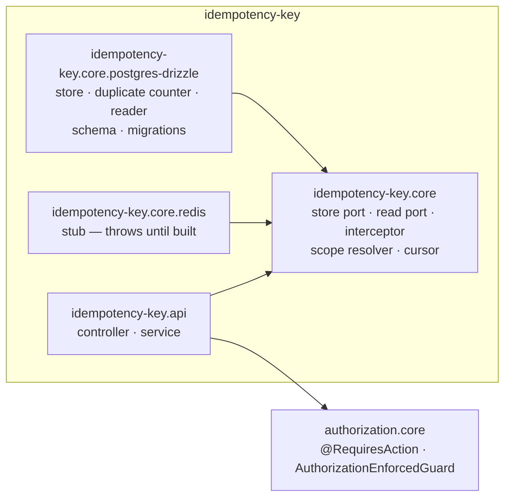
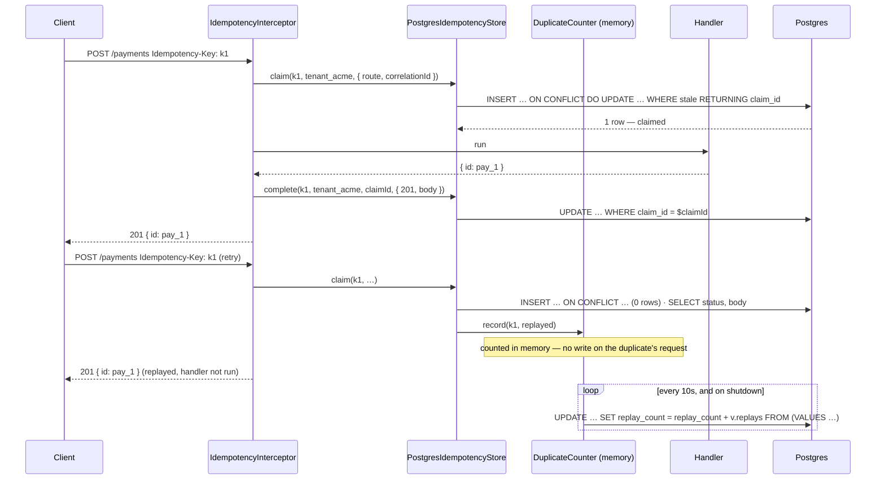

# Idempotency Key — Developer Guide

**For:** a developer new to `idempotency-key` — to understand how it works end to end, change it safely, and build the
next module the same way. **Covers:** the four backend packages (NestJS), how a consuming app wires them, the claim
(write) and read paths, security, data, testing, how-tos, and the 2026-10 review.
**Companion docs:** [`README.md`](./README.md) (what the module is, how to consume it) ·
[`AUDIT-REPORT.md`](./AUDIT-REPORT.md) (review verdict and gaps) ·
[`../MODULE-GUIDE-TEMPLATE.md`](../MODULE-GUIDE-TEMPLATE.md) (what every module's guide covers).

Code excerpts are trimmed (`// …`) but otherwise exactly what's in the files named above them. Paths are relative to
`ascendra-commons/idempotency-key/` unless they start with a repo name.

---

## Contents

1. [What it does, in one minute](#1-what-it-does-in-one-minute)
2. [The packages and what depends on what](#2-the-packages-and-what-depends-on-what)
3. [NestJS building blocks used here](#3-nestjs-building-blocks-used-here)
4. [Wiring it into an app](#4-wiring-it-into-an-app)
5. [The claim path — one request, a retry, and a stale take-over](#5-the-claim-path--one-request-a-retry-and-a-stale-take-over)
6. [The read path — one request, end to end](#6-the-read-path--one-request-end-to-end)
7. [Every endpoint](#7-every-endpoint)
8. [Security model](#8-security-model)
9. [Data model, indexes and migrations](#9-data-model-indexes-and-migrations)
10. [Testing](#10-testing)
11. [How to change things](#11-how-to-change-things)
12. [Review (2026-10)](#12-review-2026-10)
13. [File map](#13-file-map)

---

## 1. What it does, in one minute

Makes a retried request safe. A client sends an `Idempotency-Key` header; the first request with that key **claims**
it and runs; a repeat gets the first one's saved response back (a **replay**) — or a `409` if the first is still
running (a **conflict**) — and the handler never runs twice. A payer double-clicking "Pay" and a network retry
resubmitting an unchanged request are the cases it exists for. On top, it counts what it absorbed and the two ways it
can fail, and a read API shows them to support / ops.

| Term | Meaning |
|---|---|
| **Claim** | One row in `commons_idempotency_key`, per (key, scope): `pending` while the first request runs, `completed` with its saved status code and body after. |
| **Scope** | Whose key it is — the signed-in actor's tenant (or the actor, platform-side) by default. One tenant's key can't collide with another's. |
| **Replay** | A repeat request answered with the saved response. Counted per claim (`replay_count`). |
| **Conflict** | A repeat request turned away with a `409` while the first was still `pending` (`conflict_count`). |
| **Stale** | A `pending` claim older than `staleAfterSeconds` — presumed abandoned (a crash, a hung handler). |
| **Reclaim** | A later request taking over a stale claim (`reclaim_count`). *Possibly* a duplicate run — the original may still have been going. |
| **Ran twice** (late complete) | The original finished after it was reclaimed; its result was discarded (`late_complete_no_op_count`). *Confirmed* — the handler ran twice. |
| **Route** | The endpoint's route *pattern* (`/invoices/:id/send`) — never the resolved URL. |
| **Correlation id** | The caller's `x-correlation-id`, when well-formed — joins a claim to the same id in other modules. |

---

## 2. The packages and what depends on what



| Package | Ships | Never depends on |
|---|---|---|
| `idempotency-key.core` | `IdempotencyStore` (write port), `IdempotencyObservabilityPort` (read port) and its DTOs, `IdempotencyInterceptor`, `IdempotencyScopeResolver` + `ActorScopeResolver`, `IdempotencyModule`, the keyset cursor + `InvalidIdempotencyCursorError` | a database, `authorization` |
| `idempotency-key.core.postgres-drizzle` | `PostgresIdempotencyStore`, `PostgresIdempotencyDuplicateCounter`, `PostgresIdempotencyObservabilityService`, the Drizzle table, numbered migrations, two modules | HTTP, `authorization` |
| `idempotency-key.core.redis` | `RedisIdempotencyStore` — a stub that throws `RedisIdempotencyStoreNotImplementedError` (Model 2's seam) | a database |
| `idempotency-key.api` | `IdempotencyController`, `IdempotencyApiService`, `IdempotencyApiModule`, `IDEMPOTENCY_ACTIONS` | a stack adapter — it reads through `IDEMPOTENCY_OBSERVABILITY_PORT` |

No dependency on any other pattern but `authorization.core` (for the read API's gate). Cleanup is a plain `DELETE` the
app schedules itself (§4). `scripts/check.js` enforces the boundaries.

---

## 3. NestJS building blocks used here

### 3.1 An interceptor — the whole pattern wraps the handler

Not a guard (it needs the handler's result to save it) and not middleware (it needs the route and the handler's
`@HttpCode`). The consumer opts in per endpoint; the module never applies it globally.

```ts
// idempotency-key.core/idempotency.interceptor.ts
@Injectable()
export class IdempotencyInterceptor implements NestInterceptor {
  // …
  async intercept(context: ExecutionContext, next: CallHandler): Promise<Observable<unknown>> {
    const request = context.switchToHttp().getRequest<MinimalRequest>();
    const key = request.headers['idempotency-key'];
    if (!key || typeof key !== 'string') return next.handle(); // endpoint doesn't require it, or client omitted it
    if (!IDEMPOTENCY_KEY.test(key)) {
      throw new BadRequestException('"Idempotency-Key" must be 1–255 printable ASCII characters — a UUID is the usual choice');
    }
    // …
```

### 3.2 Dynamic modules — `forRoot(config)`, every one taking `imports`

`IdempotencyModule` is pure token wiring. It **exports** the interceptor's own dependencies, because a controller's
`@UseInterceptors(IdempotencyInterceptor)` is instantiated in the controller's module, from what that module can see:

```ts
// idempotency-key.core/idempotency.module.ts
return {
  module: IdempotencyModule,
  imports: config.imports ?? [],
  providers: [
    { provide: IDEMPOTENCY_STORE, useExisting: config.storeToken },
    scopeResolverProvider,
    IdempotencyInterceptor,
  ],
  // A controller's @UseInterceptors(IdempotencyInterceptor) is built in *its* module, from what that module can
  // see — so the interceptor's own dependencies are exported along with it.
  exports: [IDEMPOTENCY_STORE, IDEMPOTENCY_SCOPE_RESOLVER, IdempotencyInterceptor],
};
```

The Postgres store module refuses a bad `staleAfterSeconds` at boot rather than at the first request:

```ts
// idempotency-key.core.postgres-drizzle/postgres-idempotency-store.module.ts
if (!(typeof config?.staleAfterSeconds === 'number') || !(config.staleAfterSeconds > 0) || !Number.isFinite(config.staleAfterSeconds)) {
  throw new Error(
    `PostgresIdempotencyStoreModule.forRoot: staleAfterSeconds must be a finite number > 0 ` + // …
```

### 3.3 Injection tokens — symbols, bound with `useExisting` / `useValue`

```ts
// idempotency-key.core/tokens.ts
export const IDEMPOTENCY_STORE = Symbol('IDEMPOTENCY_STORE');
export const IDEMPOTENCY_SCOPE_RESOLVER = Symbol('IDEMPOTENCY_SCOPE_RESOLVER');
export const IDEMPOTENCY_OBSERVABILITY_PORT = Symbol('IDEMPOTENCY_OBSERVABILITY_PORT');

// idempotency-key.core.postgres-drizzle/postgres-idempotency-store.module.ts
providers: [
  { provide: IDEMPOTENCY_SQL_EXECUTOR, useExisting: config.sqlExecutorToken },
  { provide: IDEMPOTENCY_STORE_OPTIONS, useValue: { staleAfterSeconds: config.staleAfterSeconds } },
  { provide: IDEMPOTENCY_DUPLICATE_COUNTER_OPTIONS, useValue: config.duplicateCounter ?? {} },
  PostgresIdempotencyDuplicateCounter,
  PostgresIdempotencyStore,
  { provide: POSTGRES_IDEMPOTENCY_STORE, useExisting: PostgresIdempotencyStore },
],
```

### 3.4 Ports — interfaces the core owns

```ts
// idempotency-key.core/idempotency-store.port.ts
export interface IdempotencyStore {
  claim(key: string, scope: string, context?: ClaimContext): Promise<ClaimResult>;
  complete(key: string, scope: string, claimId: string, response: CachedResponse): Promise<void>;
}

// idempotency-key.core/idempotency-observability.port.ts
export interface IdempotencyObservabilityPort {
  getClaim(key: string, scope: string): Promise<IdempotencyClaimRecord | null>;
  getClaimResponse(key: string, scope: string): Promise<CachedResponse | null>;
  listClaims(query?: ClaimQuery): Promise<ClaimPage>;
  claimHealthSummary(query?: ClaimHealthQuery): Promise<ClaimHealthSummary>;
  claimsByRoute(query?: ClaimHealthQuery): Promise<RouteClaimCount[]>;
}
```

### 3.5 Lifecycle hooks — flush the duplicate counts on shutdown

```ts
// idempotency-key.core.postgres-drizzle/duplicates/postgres-idempotency-duplicate-counter.ts
async onModuleDestroy(): Promise<void> {
  clearInterval(this.timer);
  await this.flush();
}
```

`onModuleDestroy` runs on `SIGTERM` only when the app calls `app.enableShutdownHooks()`.

### 3.6 Guards and decorators on the read API

Two actions: `idempotency.view` for everything, `idempotency.view-response` for the one endpoint that returns a body.

```ts
// idempotency-key.api/idempotency.controller.ts
@Controller('idempotency-keys')
@UseGuards(AuthorizationEnforcedGuard)
export class IdempotencyController {
  // …
  @Get(':scope/:key/response')
  @RequiresAction(IDEMPOTENCY_ACTIONS.VIEW_RESPONSE)
  response(@Param('scope') scope: string, @Param('key') key: string) {
    return this.service.getClaimResponse(key, scope);
  }
```

---

## 4. Wiring it into an app

The sandbox is the reference consumer:

```ts
// ascendra-commons-sandbox/src/modules/commons/idempotency.ts (trimmed)
export const IDEMPOTENCY_STALE_AFTER_SECONDS = 5; // low on purpose — a product measures its slowest endpoint's p99

export const idempotency = IdempotencyModule.forRoot({
  storeToken: POSTGRES_IDEMPOTENCY_STORE,
  imports: [
    PostgresIdempotencyStoreModule.forRoot({
      sqlExecutorToken: DATABASE_CONNECTION,
      staleAfterSeconds: IDEMPOTENCY_STALE_AFTER_SECONDS,
      imports: [DatabaseModule],
    }),
  ],
});

export const idempotencyApi = IdempotencyApiModule.forRoot({
  imports: [PostgresIdempotencyObservabilityModule.forRoot({ sqlExecutorToken: DATABASE_CONNECTION, imports: [DatabaseModule] })],
});

// … IdempotencyCleanupTask, at boot and hourly:
//   delete from commons_idempotency_key where created_at < now() - make_interval(hours => 24)
```

```ts
// ascendra-commons-sandbox/src/demo/idempotent-demo.controller.ts
@Controller('demo')
@NoActionRequired()
@UseInterceptors(IdempotencyInterceptor)
export class IdempotentDemoController {
  @Post('payments')
  async payment(@Body() body: { amount: number; currency: string; payer: Party }, @Headers(DELAY_HEADER) delay?: string) {
    // …
```

```ts
// ascendra-commons-sandbox/src/modules/commons/authorization.ts
'platform-admin': [AUDIT_ACTIONS.VIEW, RATE_LIMIT_ACTIONS.VIEW, IDEMPOTENCY_ACTIONS.VIEW, IDEMPOTENCY_ACTIONS.VIEW_RESPONSE],
'platform-support': [RATE_LIMIT_ACTIONS.VIEW, IDEMPOTENCY_ACTIONS.VIEW],
```

**Checklist**

1. `node ascendra-commons.js add idempotency-key/idempotency-key.core.postgres-drizzle idempotency-key/idempotency-key.api`.
2. Apply the migrations (`0001`–`0002`).
3. Measure the slowest endpoint you'll protect (its real p99, external calls included) and set `staleAfterSeconds`
   above it. Too low reintroduces the duplicate the pattern exists to stop (§5, "Ran twice").
4. `IdempotencyModule.forRoot({ storeToken: POSTGRES_IDEMPOTENCY_STORE, imports: [PostgresIdempotencyStoreModule.forRoot(…)] })`.
5. `@UseInterceptors(IdempotencyInterceptor)` on each endpoint where a duplicate is costly — never globally. An
   endpoint reachable without a signed-in actor (a signed payment link) needs its own `scopeResolverToken`.
6. Schedule the cleanup — a plain `DELETE … where created_at < now() - interval '24 hours'` (safe to run concurrently).
   Keep it apart from `staleAfterSeconds`: one is how long a *finished* claim protects retries, the other how long a
   *running* one may sit.
7. Optional read API: `IdempotencyApiModule.forRoot({ imports: [PostgresIdempotencyObservabilityModule.forRoot(…)] })`;
   grant `idempotency.view` to support / ops, `idempotency.view-response` to the few who must see what a client got back.
8. `app.enableShutdownHooks()`, so the duplicate counts flush on deploy.

---

## 5. The claim path — one request, a retry, and a stale take-over



**The claim** is one atomic statement. A fresh insert and a stale take-over both return a row; a recent `pending` or a
`completed` conflict returns none, and a second read classifies it. `(xmax = 0)` tells the two winning cases apart in the
same statement:

```ts
// idempotency-key.core.postgres-drizzle/postgres-idempotency-store.ts
const won = await this.db.execute(sql`
  insert into commons_idempotency_key (key, scope, status, claim_id, correlation_id, route)
  values (${key}, ${scope}, 'pending', ${claimId}, ${correlationId}, ${route})
  on conflict (key, scope) do update
    set status = 'pending', created_at = now(), claim_id = ${claimId},
        correlation_id = ${correlationId}, route = ${route},
        reclaim_count = commons_idempotency_key.reclaim_count + 1
    where commons_idempotency_key.status = 'pending'
      and commons_idempotency_key.created_at < now() - make_interval(secs => ${this.options.staleAfterSeconds})
  returning claim_id, (xmax = 0) as inserted
`);
if (won.rows.length === 1) {
  return { status: 'claimed', claimId, reclaimedStale: won.rows[0].inserted !== true };
}
// … readRow → classify → this.duplicates.record(key, scope, 'replayed' | 'conflict')
```

**The interceptor** saves the handler's *real* status (`@HttpCode()`, else Nest's default), waits for the save before
the response leaves (`switchMap`, not `tap` — a retry in that gap would get a wrong `409`), and replays a saved error *as*
that error. Only a definitive `HttpException` is saved; an unexpected throw isn't, so a retry re-attempts:

```ts
// idempotency-key.core/idempotency.interceptor.ts
if (claim.status === 'completed') {
  const { statusCode, body } = claim.response;
  return statusCode >= 400
    ? throwError(() => new HttpException(body as string | Record<string, unknown>, statusCode))
    : of(body);
}
if (claim.status === 'in_progress') throw new ConflictException();
// …
return next.handle().pipe(
  switchMap((body) => from(this.store.complete(key, scope, claimId, { statusCode, body })).pipe(map(() => body))),
  catchError((err: unknown) => {
    const cache =
      err instanceof HttpException
        ? this.store.complete(key, scope, claimId, { statusCode: err.getStatus(), body: err.getResponse() })
        : Promise.resolve();
    return from(cache).pipe(switchMap(() => throwError(() => err)));
  }),
);
```

**What gets stored** — the key only if 1–255 printable ASCII (else `400`, before anything is claimed), the route
*pattern*, and the correlation id only if 1–128 of `[A-Za-z0-9._:-]`:

```ts
// idempotency-key.core/idempotency.interceptor.ts
const IDEMPOTENCY_KEY = /^[\x20-\x7E]{1,255}$/;
const CORRELATION_ID = /^[A-Za-z0-9._:-]{1,128}$/;

function routePattern(request: MinimalRequest, context: ExecutionContext): string {
  return (
    request.route?.path ??
    request.routeOptions?.url ??
    request.routerPath ??
    `${context.getClass().name}.${context.getHandler().name}`
  );
}
```

**A stale take-over.** A request still running past `staleAfterSeconds` can be taken over by its own retry — both now
run. `complete()` is guarded on `claim_id`, so the late original can't overwrite the new owner's saved response; its
0-row update is counted instead — the one *confirmed* duplicate:

```ts
// idempotency-key.core.postgres-drizzle/postgres-idempotency-store.ts
const updated = await this.db.execute(sql`
  update commons_idempotency_key
  set status = 'completed', status_code = ${response.statusCode}, response_body = ${response.body}
  where key = ${key} and scope = ${scope} and claim_id = ${claimId}
  returning key
`);
if (updated.rows.length > 0) return;
// … logger.warn, then best-effort:
//   update commons_idempotency_key set late_complete_no_op_count = late_complete_no_op_count + 1 where …
```

### Failure semantics — read this before you rely on it

- **A replay or `409` never waits on the count.** `record()` is synchronous and in memory; a failed flush is logged with
  how many duplicates it lost and never retried. A crash loses up to one flush interval (10 s). Past `maxBufferedKeys`
  (10,000) claims with duplicates in one interval, further duplicates aren't counted — logged at the next flush.
- **The response waits on the save.** If `complete()` fails, the request fails — and the claim stays `pending` until
  stale, so retries get `409` until then.
- **An unexpected error isn't saved.** The claim stays `pending`; a retry after `staleAfterSeconds` takes it over and
  re-runs (the right call for a timeout; a reclaim is counted).
- **A late complete is a real duplicate run.** The module counts it; it can't undo it. `staleAfterSeconds` is the lever.
- **Several instances are safe** — the claim is one atomic statement on the primary key, and the duplicate counts add
  into the same rows.

---

## 6. The read path — one request, end to end

`GET /idempotency-keys?route=/demo/payments&since=…&until=…` from the Claims screen:

1. **Browser → Next rewrite** — the testbed calls `/sandbox-api/*`, proxied to the sandbox.
2. **Guards** — `DevAuthGuard` (sets `request.actor`), `AuthorizationGuard` (`idempotency.view` or 403), then the
   controller's `AuthorizationEnforcedGuard` (500 if the global guard is missing).
3. **Controller** — query strings in, Rule 4's cursor shape out:

```ts
// idempotency-key.api/idempotency.controller.ts
async function toCursorList(page: Promise<ClaimPage>) {
  const { claims, nextCursor } = await page;
  return { data: claims, meta: { nextCursor } };
}
```

4. **Service** — validation: a bad date, `limit`, `status` or cursor, or a NUL byte in any text, is a 400; a claim that
   isn't there is a 404:

```ts
// idempotency-key.api/idempotency-api.service.ts
function textParam(name: string, value: string | undefined): string | undefined {
  if (value?.includes('\u0000')) throw new BadRequestException(`"${name}" must not contain a NUL byte`);
  return value;
}
// …
async getClaim(key: string, scope: string): Promise<IdempotencyClaimRecord> {
  const claim = await this.observability.getClaim(textParam('key', key) as string, textParam('scope', scope) as string);
  if (!claim) throw new NotFoundException(`No claim for key "${key}" in scope "${scope}" — it may have been cleaned up`);
  return claim;
}
```

5. **Reader** — one dynamic `SELECT`, newest first, keyset on `(created_at, key, scope)`, `limit + 1` rows to know
   whether there's a next page. Two details matter:
   - `created_at` is `now()` — **microseconds** — so the cursor carries it as a string, not a JS `Date` (milliseconds).
     A `Date` boundary skipped every older claim inside the boundary's millisecond (fixed in this review, §12).
   - The keyset condition leads with `created_at <=`, so the index scan starts at the boundary; the `OR` alone is only
     a filter, read from the newest row down on every page.

```ts
// idempotency-key.core.postgres-drizzle/observability/postgres-idempotency-observability.service.ts
const CURSOR_TIMESTAMP = sql.raw(
  `to_char(created_at at time zone 'UTC', 'YYYY-MM-DD"T"HH24:MI:SS.US"Z"') as cursor_at`,
);
// …
if (cursor) {
  const boundary = sql`${cursor.timestamp}::timestamptz`;
  conds.push(
    sql`created_at <= ${boundary}
      and (created_at < ${boundary} or (key, scope) < (${cursor.key}, ${cursor.scope}))`,
  );
}
// … select ${CLAIM_COLUMNS}, ${CURSOR_TIMESTAMP} … order by created_at desc, key desc, scope desc limit ${limit + 1}
```

**The body never travels with a claim.** `CLAIM_COLUMNS` selects the body's *size* only; `getClaimResponse` is the one
query that reads `response_body`:

```ts
const CLAIM_COLUMNS = sql.raw(
  'key, scope, status, status_code, octet_length(response_body::text) as response_bytes, created_at, reclaim_count, ' +
    'late_complete_no_op_count, replay_count, conflict_count, last_duplicate_at, route, correlation_id',
);
```

**The health summary and per-route counts** are aggregates over claims made since `since`; "oldest retained" is the
whole table's, whatever the period — it says how far back any period can look.

---

## 7. Every endpoint

All under `@RequiresAction('idempotency.view')` except the saved response. No tenant scoping (§8).

| Endpoint | Port call | Notes |
|---|---|---|
| `GET /idempotency-keys` | `listClaims` | Filters `status` (`pending` / `completed`), `scope`, `route` (exact pattern), `correlationId`, `since` / `until` (bound `created_at`); `limit` (default 50, ≤ 200), `cursor`. `{ data, meta: { nextCursor } }`, newest first. |
| `GET /idempotency-keys/trace/:correlationId` | `listClaims` | Every claim under one correlation id. Same shape. An unknown id is an empty page (200). |
| `GET /idempotency-keys/health` | `claimHealthSummary` | `since` → pending / completed / reclaimed counts, replay / conflict / late-complete totals, total, `oldestRetainedAt`. |
| `GET /idempotency-keys/routes` | `claimsByRoute` | `since` → per route: claims, replays, conflicts, reclaimed, late completes; most duplicates first. Bare array (bounded by routes). |
| `GET /idempotency-keys/:scope/:key` | `getClaim` | One claim — status code and body size, never the body. 404 when not kept. |
| `GET /idempotency-keys/:scope/:key/response` | `getClaimResponse` | **`idempotency.view-response`.** `{ statusCode, body }`, exactly what a retry is replayed. 404 unless kept and completed. |

`trace`, `health` and `routes` are matched before `:scope/:key` — a scope literally named `trace` can't be looked up by
`GET /idempotency-keys/trace/<key>` (the list's `scope` filter still finds it).

---

## 8. Security model

| Concern | Where it's decided | Behaviour |
|---|---|---|
| **Who you are** | The consumer's auth guard (sandbox: `DevAuthGuard`) | No / bad token → 401. `ActorScopeResolver` throws 401 if an enforced endpoint has no actor. |
| **May you read claims** | `AuthorizationGuard` + `@RequiresAction('idempotency.view')`, `AuthorizationEnforcedGuard` | Missing action → 403 naming it; a missing global guard → 500 naming the fix. |
| **May you read a body** | `@RequiresAction('idempotency.view-response')` | A separate grant — a body can hold a payer's name and email. Nothing else returns it. |
| **Whose data** | — | No tenant scope: `scope` is opaque to the module (whatever the app's resolver returns), so it can't be matched to the caller. Grant both actions to platform personas only (the sandbox denies tenant admins and members). |
| **Which application** | — | None: one table per store, no `application` column. Two apps sharing a table would share keys (AUDIT-REPORT, P2). |
| **Key collision across tenants** | `IdempotencyScopeResolver` | The claim is per (key, scope); the default scope is the actor's tenant, so tenant A's key never replays tenant B's response. |
| **What's stored** | `IdempotencyInterceptor` | The key only if 1–255 printable ASCII (else 400); the route **pattern**, never the URL; the correlation id only if 1–128 of `[A-Za-z0-9._:-]`. |
| **Personal data** | — | The saved body, unredacted, for the retention period (24 h in the sandbox). See AUDIT-REPORT, P1. |
| **Injection** | Every SQL value is a bound parameter — the cursor's parts and `staleAfterSeconds` included. | — |
| **Bad input** | Service + reader + interceptor | Bad date / number / status / cursor / NUL → 400; missing claim → 404. No 500 for a caller's mistake (§12 probes). |
| **Write amplification** | `PostgresIdempotencyDuplicateCounter` | A client hammering one key costs one row update per flush, however many repeats it sent. |

---

## 9. Data model, indexes and migrations

```sql
-- the table's shape after migrations 0001–0002 (persistence/idempotency-key.schema.ts mirrors it)
"commons_idempotency_key" (
  "key"                       text        NOT NULL,                  -- the client's Idempotency-Key (≤ 255 ASCII)
  "scope"                     text        NOT NULL,                  -- whose key — the tenant / actor
  "status"                    text        NOT NULL DEFAULT 'pending', -- 'pending' | 'completed'
  "claim_id"                  uuid        NOT NULL,                  -- the current owner's token; complete() is guarded on it
  "status_code"               integer,
  "response_body"             jsonb,                                 -- what a retry is replayed — personal data, possibly
  "created_at"                timestamptz NOT NULL DEFAULT now(),    -- reset on a reclaim
  "reclaim_count"             integer     NOT NULL DEFAULT 0,
  "late_complete_no_op_count" integer     NOT NULL DEFAULT 0,
  "correlation_id"            text,
  "replay_count"              integer     NOT NULL DEFAULT 0,        -- 0002
  "conflict_count"            integer     NOT NULL DEFAULT 0,        -- 0002
  "last_duplicate_at"         timestamptz,                           -- 0002
  "route"                     text,                                  -- 0002 — the pattern
  PRIMARY KEY ("key", "scope")
)
```

Checked with `EXPLAIN` on the sandbox (`enable_seqscan = off`) — every read uses an index:

| Index | Serves |
|---|---|
| `…_pkey` `(key, scope)` | The claim, `complete()`, the duplicate-count `UPDATE … FROM VALUES`, `getClaim` / `getClaimResponse`. |
| `…_created_at_idx` `(created_at)` | The list newest-first and its date range (backward scan + an incremental sort on `key, scope` — microsecond timestamps almost never tie, so the sort groups are single rows), the keyset's `created_at <=`, the health and per-route aggregates over `since`, "oldest retained", the cleanup `DELETE`. |
| `…_status_idx` `(status, created_at)` | In progress (`status = 'pending'`). |
| `…_route_idx` `(route, created_at)` | The list filtered by route (the planner picks `created_at` on the sandbox's 400 rows; the route index wins as a route's share shrinks). |
| `…_correlation_idx` `(correlation_id)` | A trace; the list's correlation filter. |

| Migration | What |
|---|---|
| `0001_idempotency_key.sql` | The table, the time / status / correlation indexes. |
| `0002_idempotency_duplicates_and_route.sql` | `replay_count`, `conflict_count`, `last_duplicate_at`, `route` + `(route, created_at)`. |

Released migrations are never edited (`scripts/check.js`); a change is the next number, with the schema.

---

## 10. Testing

```
npx vitest run idempotency-key      # from the ascendra-commons root — 12 files, 103 tests
npx tsc --noEmit -p .
node scripts/check.js               # boundaries, migration layout, released migrations, breaking footers
```

The store, counter and reader are tested without a database: a fake `SqlExecutor` records the Drizzle `SQL`, rendered
with `PgDialect` to assert the text and bound values. The interceptor is tested with a fake `ExecutionContext` and
store:

```ts
// idempotency-key.core/idempotency.interceptor.spec.ts (trimmed)
it.each([
  ['longer than 255 characters', 'k'.repeat(256)],
  ['non-ASCII', 'order-✓'],
  ['a control character', 'order\t1'],
])('rejects a key %s with a 400, before resolving a scope or claiming', async (_label, key) => {
  // …
  await expect(interceptor.intercept(fakeContext({ 'idempotency-key': key }), handler)).rejects.toBeInstanceOf(BadRequestException);
  expect(resolver.resolveScope).not.toHaveBeenCalled();
  expect(store.claim).not.toHaveBeenCalled();
});
```

**Not covered by specs:** SQL against a real Postgres — the atomic claim under concurrency, `xmax = 0`, the
`UPDATE … FROM (VALUES …)` merge, microsecond cursors and the plans were verified against the sandbox's Postgres 16
during the review (§12), not in CI.

---

## 11. How to change things

### Add a filter to the list
1. `ClaimQuery` in the read port; the reader's `conds`; an index if a screen uses it (`EXPLAIN` first).
2. `ClaimQueryDto` + the controller's `@Query` + the service's mapping (validate it there — a bad value is a 400; text
   through `textParam`).
3. Specs for each layer; the API README's table; the UI's `idempotencyQueryDefs` field.

### Add an endpoint
Port method → adapter → service (validation, 404s) → controller (`@RequiresAction`, the wire shape) → module spec routing
→ README. A list returns `{ data, meta: { nextCursor } }`; a bounded collection a bare array. Never return
`response_body` outside `getClaimResponse`.

### Count something new on a claim
A column in the next migration + the schema + `CLAIM_COLUMNS` + `mapRow` + the record type. If it's counted on the
duplicate path, add it to `PostgresIdempotencyDuplicateCounter` — never a write on the request.

### Change the table
The next numbered migration + `idempotency-key.schema.ts` + the store's SQL + `CLAIM_COLUMNS` / `mapRow`, together.
Breaking for the API? `!` and a `BREAKING CHANGE:` footer.

### Ship a change to the sandbox
```
# in ascendra-commons: commit (tests + check.js green)
# in ascendra-commons-sandbox:
node ascendra-commons.js update --yes      # or --from ../ascendra-commons for unpushed work
npm run db:migrate && npx nest build       # then restart dist/main, and probe with curl as a dev user
```

---

## 12. Review (2026-10)

**Fixed**

| Before | After | Commit |
|---|---|---|
| Replays and `409`s left no trace; claims had no endpoint | Counted per claim in memory, added every 10 s; the route pattern recorded; `GET …/routes`, `health?since` (**breaking**: `claim(key, scope, context?)`) | `493d657` |
| The API open without the global guard; list / trace returned the domain type; a bad `limit` / cursor → 500 | `AuthorizationEnforcedGuard`; Rule 4 `{ data, meta }` (**breaking**); 400s, `InvalidIdempotencyCursorError` | `26fe0a8` |
| The saved body travelled with every claim read | Claims carry `statusCode` + `responseBytes`; the body behind `idempotency.view-response` (**breaking**) | `664b4b5` |
| `@UseInterceptors(IdempotencyInterceptor)` outside the importing module failed to boot | `IdempotencyModule` exports the interceptor's dependencies | `ef4519c` |
| The cursor carried a JS `Date` (ms) over a µs column — page 2 skipped the older claims in the boundary's millisecond (reproduced: two claims 0.4 ms apart, `limit=1`, page 2 empty); a `|` in a key broke the cursor; each page filtered from the newest row | A µs ISO string in a JSON cursor; `created_at <=` leads the keyset (**breaking**: cursor helpers take strings) | `ea88650` |
| `Idempotency-Key` stored as sent — an 8,000-char key indexed; a 4,000-char random one broke the btree row limit: a **500 on the payment** | 1–255 printable ASCII, else 400 before anything is claimed (**breaking**) | `b3758fc` |
| A missing claim / saved response → 200 with an empty body; `?status=bogus` → an empty list; a NUL byte → 500 | 404; 400 naming the statuses; 400 | `0e96fc1` |

**Probed on the sandbox after the fixes** — none is a 500: `since=yesterday`, `until=2026-13-45`, `limit=abc|0|-1`,
`limit=99999` (capped), a garbage cursor, a pre-fix cursor, `status=bogus`, NUL in the path / `route`, a 4,000-char key.
Paging the whole store 7 at a time returns all 401 claims once each. Every screen read uses an index (`EXPLAIN`,
`enable_seqscan = off`). The Claims tile and every endpoint row equal the list they open (401; 205 / 95 / 60 / 41).

**Open** — see [`AUDIT-REPORT.md`](./AUDIT-REPORT.md).

---

## 13. File map

```
idempotency-key/
├── README.md · GUIDE.md · AUDIT-REPORT.md
├── idempotency-key.core/
│   ├── idempotency.interceptor.ts          the pattern — key rule, claim, replay / 409, save the real status
│   ├── idempotency-store.port.ts           write port — atomic claim, guarded complete
│   ├── idempotency-observability.port.ts   read port + every DTO
│   ├── idempotency-scope-resolver.port.ts · actor-scope-resolver.ts
│   ├── idempotency.module.ts               token wiring; exports the interceptor's dependencies
│   ├── keyset-cursor.ts                    encode / decode (µs, JSON) · InvalidIdempotencyCursorError
│   └── claim-result.ts · cached-response.interface.ts · idempotency-store-options.ts · tokens.ts · index.ts
├── idempotency-key.core.postgres-drizzle/
│   ├── postgres-idempotency-store.ts       the atomic claim, the guarded complete, late-complete count (+ module)
│   ├── duplicates/                         in-memory replay / 409 counter, flushed every 10 s
│   ├── observability/                      reader — claim, saved response, list, health, per route (+ module)
│   ├── persistence/                        schema · SqlExecutor
│   ├── migrations/                         0001 table · 0002 duplicates and route
│   └── tokens.ts · index.ts
├── idempotency-key.core.redis/             Model 2 stub (+ module, tokens)
└── idempotency-key.api/
    ├── idempotency.controller.ts           routes → service → wire shape
    ├── idempotency-api.service.ts          validation, 404s
    ├── idempotency-api.module.ts · idempotency-api.options.ts · dto/
    └── mocks.html                          the screens' design reference
```

The UI lives in `ascendra-commons-ui`: `packages/idempotency-key.ui/` (api client, links, nav, query defs) and the
screens in `testbed/app/observability/idempotency/` (Overview, Claims + claim and trace sheets).
