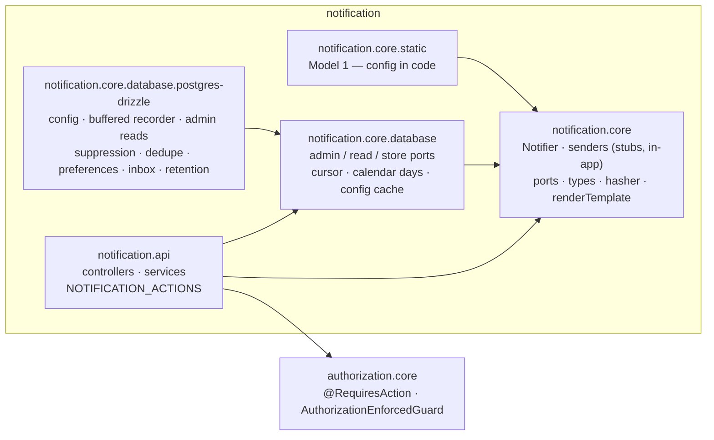
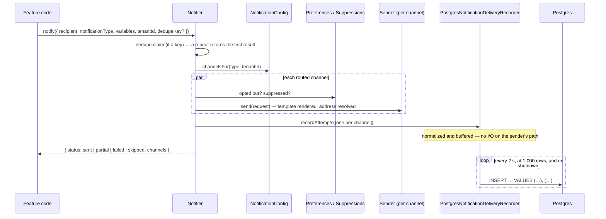

# Notification — Developer Guide

**For:** a developer new to `notification` — to understand how it works end to end, change it safely, and build the
next module the same way. **Covers:** the five packages (NestJS), how a consuming app wires them, the send path and
the log behind it, the read and admin API, the user's own preferences and inbox, security, data, testing, how-tos, and
the 2026-10 review.
**Companion docs:** [`README.md`](./README.md) (what the module is, how to consume it) ·
[`AUDIT-REPORT.md`](./AUDIT-REPORT.md) (review verdict and gaps) ·
[`../MODULE-GUIDE-TEMPLATE.md`](../MODULE-GUIDE-TEMPLATE.md) (what every module's guide covers) ·
[`notification.api/mocks.html`](./notification.api/mocks.html) (the console, screen by screen).

Code excerpts are trimmed (`// …`) but otherwise exactly what's in the files named above them. Paths are relative to
`ascendra-commons/notification/` unless they start with a repo name.

---

## Contents

1. [What it does, in one minute](#1-what-it-does-in-one-minute)
2. [The packages and what depends on what](#2-the-packages-and-what-depends-on-what)
3. [NestJS building blocks used here](#3-nestjs-building-blocks-used-here)
4. [Wiring it into an app](#4-wiring-it-into-an-app)
5. [The send path — how notify() becomes delivery rows](#5-the-send-path--how-notify-becomes-delivery-rows)
6. [The read path, retry, and the console's numbers](#6-the-read-path-retry-and-the-consoles-numbers)
7. [Every endpoint](#7-every-endpoint)
8. [Security model](#8-security-model)
9. [Data model, indexes and migrations](#9-data-model-indexes-and-migrations)
10. [Testing](#10-testing)
11. [How to change things](#11-how-to-change-things)
12. [Review (2026-10)](#12-review-2026-10)
13. [File map](#13-file-map)

---

## 1. What it does, in one minute

Feature code never talks to SES or Twilio — it calls `Notifier.notify({ recipient, notificationType, variables,
tenantId })` and moves on. The module looks up which **channels** the type is **routed** to (for that tenant, else the
default), renders each channel's **template** with the variables, and hands it to that channel's **sender** — skipping
a channel the user turned off or an address that bounced before. `notify()` never throws; every attempt is written to
the **delivery log**, which the console reads: did it reach them, and if not, why.

| Term | Meaning |
|---|---|
| **Notification type** | What happened, named for it (`invoice.sent`). Declared by the app (`forRoot({ types })`) with a description, audience, variables with samples, and `required`. |
| **Channel** | `email`, `sms`, `whatsapp`, `in_app`. Each has one sender. |
| **Route** | Which channels a type goes out on — a default (`tenant_id` null) and a tenant's own, which replaces it for that tenant. |
| **Template** | A type's text on a channel (subject, body, HTML for email) with `{{variables}}`. A tenant's own wins (white-labelling). WhatsApp has none — its templates live at Meta. |
| **Provider account** | A channel's credential — the platform's (tenantless sends, the fallback) or a tenant's own. Write-only. |
| **Delivery** | One attempt on one channel — a row in `commons_notification_delivery`. `sent` (the provider took it), `delivered` / `bounced` (its callback), `failed`, `skipped` (suppressed, opted out). |
| **Recipient** | A user (`user:<id>`, resolved by the app's `UserContactResolver`) or a guest (a raw address, used once, **never stored**). |
| **Recipient key** | `user:<id>`, or a keyed hash of a guest's address — what the log searches and suppresses by. |
| **Suppression** | A recipient a channel stopped sending to after a hard bounce or a complaint. Applies app-wide. |
| **Preference** | A user's on/off rule per type × channel (`*` for all); the most specific wins; a `required` type ignores them. |
| **Inbox** | Where `in_app` delivers — a user's own list, read in the app (the bell). |
| **Test send** | A real send marked `is_test` — hidden from the log by default, left out of the numbers. |
| **Retry** | A failed delivery resent to its user on its channel, once; the new row has `retry_of`, the old one reads `retriedBy`. |
| **Application** | Which Ascendra app wrote the row. Stamped by every Postgres adapter, scoped on every read. |

---

## 2. The packages and what depends on what



| Package | Ships | Never depends on |
|---|---|---|
| `notification.core` | `Notifier`, `NotificationModule.forRoot`, the stub email / SMS / WhatsApp senders and the real `InAppNotificationSender`; the config, sender, recorder, contact-resolver, suppression, dedupe, preferences and inbox ports; declared types, `NotificationRecipientHasher`, `renderTemplate`, `escapeHtml` | a database, HTTP |
| `notification.core.static` | `StaticNotificationConfig` (Model 1 — routes, templates, credentials from an object) | a database |
| `notification.core.database` | The admin / observability / preference / inbox **ports** and DTOs, `ConfigCache`, the JSON keyset cursor, calendar days | SQL, HTTP |
| `notification.core.database.postgres-drizzle` | Every port on Postgres: config (Model 2), the buffered delivery recorder, admin reads, suppression list, deduplicator, preferences, inbox, retention; Drizzle schema, 12 migrations, a seed from Model 1's data | HTTP, authorization |
| `notification.api` | Eight controllers (observability, config admin, types, test send, retry, suppressions, the user's preferences, the user's inbox), their services, `NotificationApiModule`, `NOTIFICATION_ACTIONS` | a stack adapter — it reads through the ports |

`scripts/check.js` enforces the boundaries.

---

## 3. NestJS building blocks used here

### 3.1 A dynamic module that is pure token wiring

`NotificationModule.forRoot()` ships no config implementation. It aliases `NOTIFICATION_CONFIG` to whichever token the
app names, and every optional store the same way — so Model 1 and Model 2 wire identically, and `Notifier` never knows
which is bound.

```ts
// notification.core/notification.module.ts
export interface NotificationModuleConfig {
  configToken: OverrideToken;
  userContactResolverToken?: OverrideToken;
  deliveryRecorderToken?: OverrideToken;
  senders?: Partial<Record<NotificationChannel, Type<NotificationSender>>>;
  types?: NotificationTypeDefinition[];
  recipientHashKey?: string;
  suppressionListToken?: OverrideToken;
  deduplicatorToken?: OverrideToken;
  preferencesToken?: OverrideToken;
  inboxToken?: OverrideToken;
  dedupeWindowMs?: number;
  /** Whatever module(s) export the token(s) above — `useExisting` only resolves a token this module can already see. */
  imports?: DynamicModule['imports'];
}
```

It has to be a `forRoot()` option, not "bind the token in your own module": `Notifier` and the senders are built in
*this* module's scope, and Nest's provider registries are per-module.

### 3.2 Senders are classes built inside the module

`senders: { email: SesEmailSender }` replaces a stub. The class is constructed here, so it can inject
`NOTIFICATION_CONFIG` (its credential via `providerConfigFor`, its template), `USER_CONTACT_RESOLVER`, and anything a
module in `imports` exports (an SDK client). A real sender returns `providerMessageId` (so a webhook can find the row)
and `rendered` (so the log can keep the message); `verify?()` backs the console's Verify.

### 3.3 Injection tokens — symbols, bound with `useExisting`

Every port has a `Symbol` token (`notification.core/tokens.ts`, `notification.core.database/tokens.ts`); each Postgres
module provides its implementation under a `POSTGRES_…` token, and the app passes that token to `forRoot`.

### 3.4 Lifecycle — the recorder flushes on shutdown

`PostgresNotificationDeliveryRecorder` implements `OnModuleDestroy`: the buffer is written when the app stops
(`app.enableShutdownHooks()`).

### 3.5 Guards and decorators on the API

Every controller declares `@UseGuards(AuthorizationEnforcedGuard)` (fails closed if the app forgot the global
`AuthorizationGuard`) and every route `@RequiresAction(NOTIFICATION_ACTIONS.…)`; `@CurrentActor()` is the caller.

```ts
// notification.api/retry/notification-retry.controller.ts
@Controller('notifications/deliveries')
@UseGuards(AuthorizationEnforcedGuard)
export class NotificationRetryController {
  @Post(':id/retry')
  @RequiresAction(NOTIFICATION_ACTIONS.RETRY)
  retry(@CurrentActor() actor: Actor, @Param('id') id: string) {
    return this.service.retry(actor, id);
  }
}
```

---

## 4. Wiring it into an app

The reference consumer is `ascendra-commons-sandbox` — every option on:

```ts
// ascendra-commons-sandbox/src/modules/commons/notification.ts
const store = {
  config: PostgresNotificationConfigModule.forRoot({ ...db, tenantCredentialFallback: true }),
  recorder: PostgresNotificationDeliveryRecorderModule.forRoot({ ...db, storeContent: true }),
  suppression: PostgresNotificationSuppressionModule.forRoot(db),
  dedupe: PostgresNotificationDedupeModule.forRoot(db),
  preferences: PostgresNotificationPreferencesModule.forRoot(db),
  inbox: PostgresNotificationInboxModule.forRoot(db),
};

export const notification = NotificationModule.forRoot({
  configToken: POSTGRES_NOTIFICATION_CONFIG,
  deliveryRecorderToken: POSTGRES_NOTIFICATION_DELIVERY_RECORDER,
  userContactResolverToken: DemoContactResolver,
  senders: { email: FakeEmailSender, sms: FakeSmsSender, whatsapp: FakeWhatsappSender },
  types: NOTIFICATION_TYPES,
  recipientHashKey: RECIPIENT_HASH_KEY,
  suppressionListToken: POSTGRES_NOTIFICATION_SUPPRESSION_LIST,
  deduplicatorToken: POSTGRES_NOTIFICATION_DEDUPLICATOR,
  preferencesToken: POSTGRES_NOTIFICATION_PREFERENCES,
  inboxToken: POSTGRES_NOTIFICATION_INBOX,
  imports: [store.config, store.recorder, store.suppression, store.dedupe, store.preferences, store.inbox, DemoNotificationDirectoryModule],
});

export const notificationApi = NotificationApiModule.forRoot({
  auditEmitterToken: AuditNotificationEmitter,        // config edits, content reads, retries → audit-logging
  tenantDirectoryToken: DemoTenantDirectory,          // coverage checks a default route for every tenant
  imports: [PostgresNotificationAdminModule.forRoot({ ...db, tenantCredentialFallback: true }), notification, /* … */],
});
```

Checklist:

1. Vendor the packages (`node ascendra-commons.js add notification`); apply the migrations (`0001`–`0012`).
2. Pick a model: `StaticNotificationConfig` (code) or `PostgresNotificationConfigModule` (per-tenant, editable).
3. Declare your types (`forRoot({ types })`) — the console lists them and validates templates against them.
4. Bind a `UserContactResolver` over your user table — with `findByIds` and `name`, so the console names recipients.
5. Write a real sender per channel (`forRoot({ senders })`), with `verify` and `providerMessageId`.
6. Write the provider webhook that calls `recorder.updateDeliveryStatus({ providerMessageId, status, suppress })` —
   without it nothing is ever `delivered` and nothing gets suppressed.
7. Set `recipientHashKey` from your secret store (16+ characters) to search guests and suppress their addresses.
8. Turn on what you need: suppression, dedupe, preferences, inbox — each a store module plus its token.
9. Schedule retention (`PostgresNotificationRetentionService`: `clearContent`, `pruneDeliveries`, `pruneInbox`,
   `pruneDedupeKeys`) — the sandbox runs it as a background job.
10. Mount `NotificationApiModule` with an `auditEmitterToken` (or content reads go unaudited) and grant the actions:
    `notification.view`, `view_content`, `manage_config`, `test_send`, `retry`.

---

## 5. The send path — how notify() becomes delivery rows



**Routing, then each channel** — a skipped channel is neither success nor failure:

```ts
// notification.core/notifier.ts
private async send(request: NotificationRequest): Promise<NotificationResult> {
  let channels: NotificationChannel[];
  try {
    channels = await this.config.channelsFor(request.notificationType, request.tenantId ?? null);
  } catch (err) {
    return { status: 'failed', reason: err instanceof Error ? err.message : 'channel_config_unavailable', channels: {} };
  }
  if (channels.length === 0) {
    return { status: 'failed', reason: 'no_channel_configured', channels: {} };
  }
  // … a retry narrows to the channels asked for
  const entries = await Promise.all(channels.map((channel) => this.dispatch(channel, request)));
  // … aggregate over the channels tried
  await this.recordDelivery(request, entries);
  return { status, channels: channelResults };
}

private async dispatch(channel, request) {
  const sender = this.senders.get(channel);
  if (!sender) return [channel, { status: 'failed', reason: 'channel_not_registered' }];
  if (await this.isOptedOut(channel, request)) return [channel, { status: 'skipped', reason: 'opted_out' }];
  if (await this.isSuppressed(channel, request)) return [channel, { status: 'skipped', reason: 'suppressed' }];
  try {
    return [channel, await sender.send(request)];
  } catch (err) {
    return [channel, { status: 'failed', reason: err instanceof Error ? err.message : 'unknown_error' }];
  }
}
```

**Rendering** — `{{name}}` filled from the variables; a missing one stays visible; in HTML every value is escaped:

```ts
// notification.core/notification-template.ts
const interpolate = (text: string, html: boolean) =>
  text.replace(/\{\{(\w+)\}\}/g, (match, key: string) => {
    const value = variables[key];
    if (value === undefined) return match;
    return html ? escapeHtml(String(value)) : String(value);
  });
```

**What each row keeps** — the recipient redacted (`user:<id>` or `raw:email`), its key, the outcome, and — with
`storeContent` — the message and its variables; a failed send keeps its variables (no body) so a retry can rebuild it:

```ts
// notification.core/notifier.ts — recordDelivery()
content: result.rendered
  ? { subject: result.rendered.subject ?? null, body: result.rendered.body, isHtml: result.rendered.isHtml ?? false, variables: request.variables }
  : result.status === 'failed'
    ? { subject: null, body: null, isHtml: false, variables: request.variables }
    : undefined,
```

### Failure semantics — read this before you rely on it

- **`notify()` never throws.** A config read that throws, a sender that throws, a store that's down — each becomes a
  `failed` result. `notifyCritical()` is the throwing variant.
- **The log never changes the outcome.** The recorder buffers in memory; `Notifier` also guards the call. A failed
  flush drops its rows (logged with how many); past 50,000 buffered rows new ones are dropped and counted.
- **Rows appear up to 2 s late** — except a retry's and a test send's: those API calls `Notifier.flushDeliveryLog()`
  before answering, because their answer links to the row.
- **A send that fails before any channel is tried writes no row** (no route, the config store down, a retry of an
  unrouted channel) — a known gap ([report](./AUDIT-REPORT.md), P1).
- **A broken preference or suppression store sends anyway** (logged) — a rare unwanted send beats a lost one. The same
  for the deduplicator.
- **A dedupe repeat writes no row** — it returns the first call's result.

---

## 6. The read path, retry, and the console's numbers

**Tenant ceiling.** Every read decides the tenant in the service, never from the request: a platform admin
(`isPlatformAdmin`, default *no tenant*) may pass `tenantId`; anyone else gets their own.

```ts
// notification.api/observability/notification-observability-api.service.ts
private async resolveTenantFilter(actor: Actor, requested?: string): Promise<string | undefined> {
  if (await this.options.isPlatformAdmin(actor)) return requested;
  return actor.tenantId ?? undefined;
}
```

**Reading the message** is its own action and every read is audited, filed under the delivery's tenant:

```ts
async getDeliveryContent(actor: Actor, id: string) {
  const delivery = await this.getDelivery(actor, id);          // the same 404 for another tenant's row
  const record = await this.port.getDeliveryContent(id);
  if (!record) throw new NotFoundException('no stored content for that delivery');
  await this.audit.record({ action: 'notification.content_viewed', actorId: actor.id, tenantId: delivery.tenantId, entityType: 'delivery', entityId: id });
  return record;
}
```

**Retry** — once, to the real user, on its channel, through the same rules:

```ts
// notification.api/retry/notification-retry-api.service.ts
if (delivery.status !== 'failed' && delivery.status !== 'bounced') throw new BadRequestException(/* … */);
if (delivery.retriedBy) throw new BadRequestException(`already retried — delivery ${delivery.retriedBy}; retry that one if it failed too`);
if (delivery.isTest) throw new BadRequestException('a test send is not retried — send another test');
if (!delivery.recipientRef.startsWith('user:')) throw new BadRequestException("a guest's address isn't stored, …");
const stored = await this.port.getDeliveryContent(id);   // the variables a failed send kept
const result = await this.notifier.notify({ recipient: { type: 'user', id }, notificationType, variables: stored.content.variables,
  tenantId: delivery.tenantId, channels: [delivery.channel], retryOf: delivery.id, correlationId });
await this.notifier.flushDeliveryLog();                   // the old row names its retry at once
```

`retriedBy` is read back per row through a partial index on `retry_of`:

```ts
// notification.core.database.postgres-drizzle/admin/postgres-notification-observability.service.ts
const RETRIED_BY = sql`(select r.id from commons_notification_delivery r
  where r.application = d.application and r.retry_of = d.id order by r.id desc limit 1) as retried_by`;
```

**Suppressions a tenant sees** — an entry is app-wide, filed under the first bouncing tenant; a tenant sees every one
that skips its sends (an `EXISTS` on the log's recipient-key index) and removes only its own:

```ts
// notification.core.database.postgres-drizzle/admin/postgres-notification-config-admin.service.ts
function affects(tenantId: string) {
  return sql`(s.tenant_id = ${tenantId} or exists (
    select 1 from commons_notification_delivery d
    where d.application = s.application and d.recipient_key = s.recipient_key and d.channel = s.channel and d.tenant_id = ${tenantId}
  ))`;
}
```

**Preferences** — the most specific rule wins; no rule means on:

```ts
// notification.core.database/notification-preference-store.port.ts
export function preferenceAllows(rules, notificationType, channel): boolean {
  let best: { enabled: boolean; specificity: number } | null = null;
  for (const r of rules) {
    if ((r.notificationType !== notificationType && r.notificationType !== ANY) || (r.channel !== channel && r.channel !== ANY)) continue;
    const specificity = (r.notificationType === ANY ? 0 : 2) + (r.channel === ANY ? 0 : 1);
    if (!best || specificity > best.specificity) best = { enabled: r.enabled, specificity };
  }
  return best?.enabled ?? true;
}
```

**The console's numbers** each have a filter that reproduces them exactly — the Overview's tiles and "why sends
failed" rows link to `GET /deliveries` with the same window and `status` (one or a list) or `reason` (a code). Stats
count whole calendar days in the viewer's zone (`?tz=`), test sends left out.

---

## 7. Every endpoint

All under `/notifications`. Gate in brackets; *self* = any signed-in user, their own rows only.

| Route | Reads / writes | Not obvious |
|---|---|---|
| `GET /deliveries` [view] | `getDeliveryHistory` | `{ data, meta: { nextCursor } }`; `status=failed,bounced`; `reason=<code>` matches `code` and `code: …`; `recipientAddress` is hashed first (needs `recipientHashKey`); `test` defaults to both — the console sends `false` |
| `GET /deliveries/:id` [view] | `getDelivery` | another tenant's is a 404; carries `retriedBy`, `recipientName` |
| `GET /deliveries/:id/content` [view_content] | `getDeliveryContent` | audited every read; 404 when not stored (cleared, skipped) |
| `POST /deliveries/:id/retry` [retry] | `Notifier.notify` | once; user recipients with stored variables; flushes the log before answering |
| `GET /stats` [view] | `getDeliveryStats` | `window=24h` rolling, `7d`/`30d` whole days in `tz`; byChannel, byType, byDay (with `failed`), byReason |
| `GET /volume` [view, platform] | `volume` | 30 days per day in `tz`, rows, rows holding content, table size |
| `GET /config/coverage-gaps` [view] | `configCoverageGaps` | a default route is checked for every tenant the directory names |
| `GET /types`, `/types/:name` [view] | catalog × config | `declared: false` for a leftover; `required`; the type's routes, templates, gaps |
| `GET·PUT /config/routes` [view · manage_config] | config admin | a route for an undeclared type is a 400 |
| `DELETE /config/routes/:type?tenantId=` [manage_config] | | 404 when absent; omitted `tenantId` = the default (platform only) |
| `GET·PUT /config/templates` · `DELETE /config/templates/:channel/:type` | | a variable the type lacks is a 400 naming it |
| `POST /config/templates/preview` [view] | `renderTemplate` | stateless; the type's samples fill what's missing |
| `GET·PUT /config/credentials` · `DELETE /config/credentials/:channel?tenantId=` | | values never returned; audited without the value |
| `POST /config/credentials/:channel/verify` [manage_config] | `sender.verify` | `{ supported, ok, detail }`; at most 10 s |
| `POST /test-send` [test_send] | `Notifier.notify` | a tenant admin: itself or a colleague; marked `is_test`; flushes the log |
| `GET /suppressions` [view] · `DELETE /suppressions/:id` [manage_config] | suppression list | `?recipientKey=&channel=`; `removable`; another tenant's entry is a 403 to remove |
| `GET·PUT /preferences/me` [self] | preference store | `*` for every type or channel; a `required` type can't be turned off (400) |
| `GET /inbox`, `/inbox/unread-count`, `POST /inbox/:id/read`, `/inbox/read-all` [self] | inbox store | `?unread=true`; another user's item is a 404 |

---

## 8. Security model

| Concern | How |
|---|---|
| Authentication | The app's; `@CurrentActor()` |
| Authorization | `@RequiresAction` on every route; `AuthorizationEnforcedGuard` fails closed without the global guard |
| Tenant scope | Forced in each service for a non-platform actor (reads, config writes, test send, retry, suppressions) |
| Application scope | Every Postgres query filters `application` |
| Existence leaks | Another tenant's delivery, content, config row or inbox item is the same 404 as a missing one |
| Message content | Its own action (`view_content`); every read audited under the delivery's tenant; cleared by retention |
| Guests | The address is used once and never stored — only `raw:<channel>` and a keyed hash |
| Credentials | Write-only; never returned; audited without the value; the stub senders log a redacted line |
| HTML email | Variables escaped in an HTML body (`escapeHtml`); stored HTML shown in the console in a sandboxed iframe |
| Injection | Every SQL value bound — dates, zones, ids, reason codes, status lists |
| Input validation | Every bad id, enum, date, cursor, limit, body field is a 400 naming it — never a 500 |
| Test sends | A tenant admin can't send to an address, only itself or a colleague in its tenant |

**Depends on the app's wiring:** the global `AuthorizationGuard`; an `auditEmitterToken` (without it content reads and
config edits aren't audited — see the report); `isPlatformAdmin` (default: no tenant); a contact resolver that reports
`tenantId` (else a tenant admin can test-send to itself only); `recipientHashKey` from a secret store.

---

## 9. Data model, indexes and migrations

Tables (all with `application`): `commons_notification_channel_route`, `_template`, `_provider_credential` (config) ·
`commons_notification_delivery` (the log) · `_suppression` · `_dedupe` · `_preference` · `_inbox`. Shapes:
`notification.core.database.postgres-drizzle/persistence/*.schema.ts`.

| Index | Serves |
|---|---|
| `delivery_list_idx (application, attempted_at desc, id desc)` | the log, newest first; the cursor; the `retriedBy` outer scan |
| `delivery_tenant_idx (…, tenant_id, attempted_at desc, id desc)` | a tenant's log |
| `delivery_type_idx (…, notification_type, …)` | Filter by type; the type page's sends |
| `delivery_recipient_list_idx (…, recipient_ref, …)` | a user's sends |
| `delivery_recipient_key_idx (…, recipient_key, …) where recipient_key is not null` | everything to a recipient; suppressions' `affects` |
| `delivery_failed_idx (…, attempted_at desc, id desc) where status in ('failed','bounced')` | failures, `status=failed,bounced`, `reason=` |
| `delivery_correlation_idx (…, correlation_id) where not null` | a request's trace |
| `delivery_content_idx (…, attempted_at) where content is not null` | retention's clear-content; volume's content counts |
| `delivery_provider_msg_idx (provider_message_id)` | the webhook's status update |
| `delivery_retry_of_idx (…, retry_of) where not null` | `retriedBy` — one probe per row |
| `suppression_uq (application, channel, recipient_key)` | the send-time check; a delivery's own entry |
| `suppression_list_idx`, `suppression_tenant_idx` | the suppressions list |
| `inbox_user_idx`, `inbox_unread_idx`, `inbox_created_idx` | the inbox, the badge, retention |
| `dedupe_expires_idx` | pruning expired keys |

Checked with `EXPLAIN` on the sandbox (`enable_seqscan = off` on ~3.5k rows): every read above uses its index; the
`retriedBy` subplan is an index scan per row (51 loops, < 0.1 ms).

Migrations `0001_config` … `0012_delivery_retried_by_index`, delivered into the app's migrations by
`ascendra-commons.js`. Never edit a released one; mirror each change in the Drizzle schema; on a large table create
an index `CONCURRENTLY`.

---

## 10. Testing

```sh
npx vitest run notification          # 39 spec files, 335 tests
rm -rf notification/node_modules/.vite   # vitest leaves a cache here — remove it after each run
npx tsc --noEmit && node scripts/check.js
```

- **Adapters** — the rendered SQL and its bound params (`dialect.sqlToQuery`), against a fake executor.
- **Services** — the rules (tenant ceiling, validation, audit, retry-once) against fake ports.
- **Modules** — real DI wiring (`notification-api.module.spec.ts`), so a missing export fails a test.

Not covered: real Postgres (only rendered SQL), real providers, the webhook (none ships). The sandbox covers the rest:
seeded through the module's own entry points, probed with bad input, walked in the console.

---

## 11. How to change things

### Add a filter to the delivery log
`DeliveryHistoryQuery` (`notification.core.database`) → a bound condition in the Postgres reader → validate it in
`NotificationObservabilityApiService` (a bad value a 400) → `@Query` in the controller → a spec at each layer. Check
the read with `EXPLAIN`; add a partial index for a rare value.

### Add a channel
Extend `NOTIFICATION_CHANNELS`, ship a stub sender, add it to `STUBS` in `notification.module.ts`, decide whether it
needs a template (`coverage-gaps`' WhatsApp rule) and a credential.

### Add a reason code
Return it from the sender as `code` or `code: detail` — the stats group by the part before the colon, and the console
words it (`notification.ui/display.ts`).

### Change a table
A new numbered migration and the same change in `persistence/*.schema.ts`; a required new field on a record is a
breaking change (`!` + `BREAKING CHANGE:`).

### Ship a change to the sandbox
Commit and push commons, then in the sandbox `node ascendra-commons.js update --yes`, `npm run db:migrate`,
`npm run build`, restart (`npm start`), and re-probe.

---

## 12. Review (2026-10)

Seven stages: code review → backend (37 commits) → the sandbox wired with every option and seeded → raw API probes →
the mock rewritten and approved → the console built and walked → hardening (this guide, `EXPLAIN`, one more fix). Every fix, with its commit, is in the
[report](./AUDIT-REPORT.md#fixed-during-the-review); the most consequential:

| Before | After |
|---|---|
| A tenant admin could read any tenant's stored message and test-send to any address | Content scoped like the row, its own action, audited; test send to itself or a colleague |
| Bad input was a 500 | A 400 naming the field, everywhere |
| One `INSERT` per send on the sender's path | Buffered, normalized, flushed when an answer links to the row |
| A retry could be sent twice | Once; the old row names its retry |
| An HTML email put a customer's name in as markup | Escaped |
| A tenant couldn't see the suppression skipping its sends | Every one that affects it, with `removable` |

Open: real senders, the webhook, the not-routed row, the audit-emitter check — [report](./AUDIT-REPORT.md#gaps).

---

## 13. File map

```
notification.core/                     Notifier, NotificationModule, senders, ports, types, hasher, templates
  notifier.ts                          notify / notifyCritical / verifyCredential / flushDeliveryLog
  notification.module.ts               forRoot — token wiring, senders, types
  notification-template.ts             renderTemplate, escapeHtml
  in-app-notification-sender.ts        the one real sender
notification.core.static/              Model 1
notification.core.database/            ports, DTOs, keyset cursor, calendar days, config cache
notification.core.database.postgres-drizzle/
  config/                              Model 2 config (routes, templates, credentials)
  delivery-log/                        the buffered recorder
  admin/                               the log, stats, volume, gaps; config admin; suppressions
  suppression/ dedupe/ preferences/ inbox/ retention/
  persistence/                         Drizzle schema
  migrations/                          0001–0012
notification.api/
  observability/ config-admin/ types/ test-send/ retry/ suppressions/ preferences/ inbox/
  shared/params.ts                     every param's validation
  mocks.html                           the console
```
