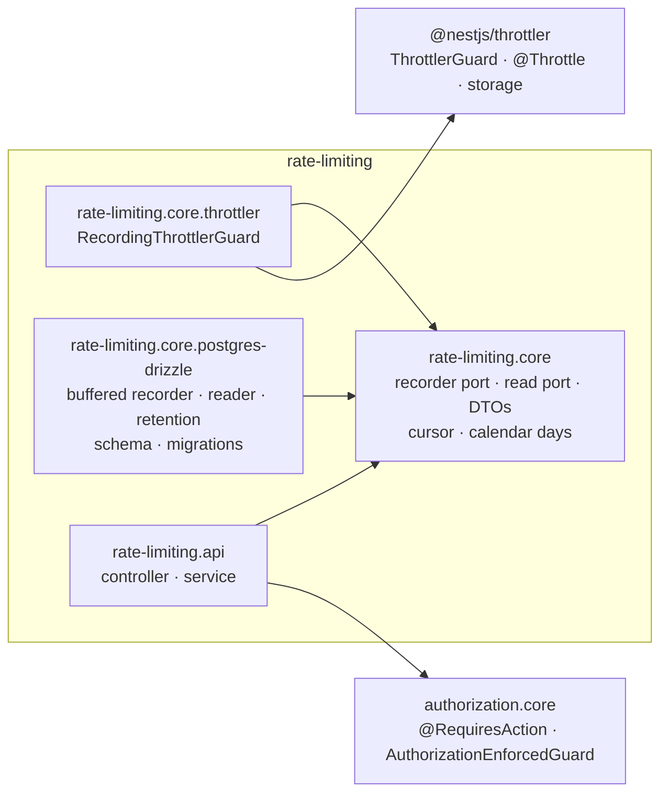
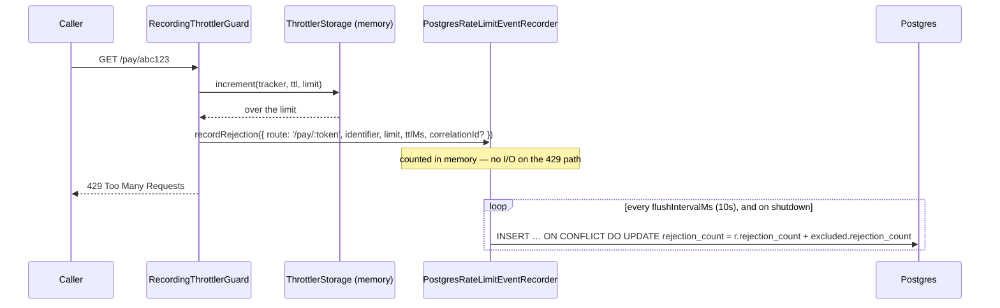

# Rate Limiting — Developer Guide

**For:** a developer new to `rate-limiting` — to understand how it works end to end, change it safely, and build the
next module the same way. **Covers:** the four backend packages (NestJS), how a consuming app wires them, the
rejection (write) and read paths, security, data, testing, how-tos, and the 2026-10 review.
**Companion docs:** [`README.md`](./README.md) (what the module is, how to consume it) ·
[`AUDIT-REPORT.md`](./AUDIT-REPORT.md) (review verdict and gaps) ·
[`../MODULE-GUIDE-TEMPLATE.md`](../MODULE-GUIDE-TEMPLATE.md) (what every module's guide covers).

Code excerpts are trimmed (`// …`) but otherwise exactly what's in the files named above them. Paths are relative to
`ascendra-commons/rate-limiting/` unless they start with a repo name.

---

## Contents

1. [What it does, in one minute](#1-what-it-does-in-one-minute)
2. [The packages and what depends on what](#2-the-packages-and-what-depends-on-what)
3. [NestJS building blocks used here](#3-nestjs-building-blocks-used-here)
4. [Wiring it into an app](#4-wiring-it-into-an-app)
5. [The rejection path — how a 429 becomes a row](#5-the-rejection-path--how-a-429-becomes-a-row)
6. [The read path — one request, end to end](#6-the-read-path--one-request-end-to-end)
7. [Every endpoint](#7-every-endpoint)
8. [Security model](#8-security-model)
9. [Data model, indexes and migrations](#9-data-model-indexes-and-migrations)
10. [Testing](#10-testing)
11. [How to change things](#11-how-to-change-things)
12. [Review (2026-10)](#12-review-2026-10)
13. [File map](#13-file-map)

---

## 1. What it does, in one minute

Bounds how often a caller can hit an endpoint — `@nestjs/throttler`'s `@Throttle()`, unchanged — and **records every
request a limit turned away**, so a route being hammered (a public payment link, most concretely) shows up on a screen
instead of vanishing as an anonymous `429`. The limiting itself is the library's; this module adds the record, the read
API over it, and retention.

| Term | Meaning |
|---|---|
| **Rejection** | One request a limit turned away — a `429`. Never stored on its own. |
| **Rejection window** | One row in `commons_rate_limit_rejection`: every rejection of one route, identifier, limit and correlation id **within one minute**, counted (`rejection_count`, first / last seen). |
| **Route** | The route *pattern* the limit was declared on (`/pay/:token`) — never the resolved URL. |
| **Identifier** (source) | What the throttler counted by — the *tracker*: an IP by default, a user id if the app says so. |
| **`(overflow)`** | The identifier rejections are counted under once the recorder's buffer holds `maxBufferedKeys` sources — many sources, counted together; the route's total stays exact. |
| **Flush** | The recorder writing its in-memory counts to Postgres — every `flushIntervalMs` (10s), and on shutdown. |
| **Correlation id** | The caller's `x-correlation-id`, when well-formed — a trace of one request / job's rejections. Rarely present: most callers turned away aren't well-behaved clients. |
| **Application** | Which Ascendra app recorded the row. Stamped by the adapter, scoped on every read. |

---

## 2. The packages and what depends on what



| Package | Ships | Never depends on |
|---|---|---|
| `rate-limiting.core` | `RateLimitEventRecorder` (write port) + `NoopRateLimitEventRecorder`, `RateLimitObservabilityPort` (read port) and its DTOs, the keyset cursor + `InvalidRateLimitCursorError`, calendar-day helpers | `@nestjs/throttler`, a database, HTTP |
| `rate-limiting.core.throttler` | `RecordingThrottlerGuard` (a `ThrottlerGuard` subclass) and `RateLimitingThrottlerModule` | a database |
| `rate-limiting.core.postgres-drizzle` | `PostgresRateLimitEventRecorder` (buffered), `PostgresRateLimitObservabilityService`, `PostgresRateLimitRetentionService`, the Drizzle table, numbered migrations, three modules | HTTP, authorization, `@nestjs/throttler` |
| `rate-limiting.api` | `RateLimitingController`, `RateLimitingApiService`, `RateLimitingApiModule`, `RATE_LIMIT_ACTIONS` | a stack adapter — it reads through `RATE_LIMIT_OBSERVABILITY_PORT` |

No dependency on any other pattern but `authorization.core` (for the read API's gate) — `background-jobs` is *not* a
dependency: retention is a plain method the app schedules itself (§4). `scripts/check.js` enforces the boundaries.

---

## 3. NestJS building blocks used here

### 3.1 Subclassing a library guard — the one hook `@nestjs/throttler` offers

The throttler's `ThrottlerGuard` decides; this module only observes. `throwThrottlingException()` is the method the
library designed to be overridden, and the only place that sees the tracker, limit and ttl together — an
`ExceptionFilter` would see a bare `ThrottlerException`.

```ts
// rate-limiting.core.throttler/recording-throttler.guard.ts
@Injectable()
export class RecordingThrottlerGuard extends ThrottlerGuard {
  // Not `logger`: ThrottlerGuard (6.7+) has its own protected `logger`, which this must not shadow.
  private readonly recordLogger = new Logger(RecordingThrottlerGuard.name);
  // …
  protected override async throwThrottlingException(
    context: ExecutionContext,
    throttlerLimitDetail: ThrottlerLimitDetail,
  ): Promise<void> {
    await this.recordRejection(context, throttlerLimitDetail);
    return super.throwThrottlingException(context, throttlerLimitDetail);
  }
```

### 3.2 Dynamic modules — `forRoot(config)`, every one taking `imports`

```ts
// rate-limiting.core.throttler/rate-limiting-throttler.module.ts
static forRoot(config: RateLimitingThrottlerModuleConfig = {}): DynamicModule {
  const recorderProvider: Provider = config.recorderToken
    ? { provide: RATE_LIMIT_EVENT_RECORDER, useExisting: config.recorderToken }
    : { provide: RATE_LIMIT_EVENT_RECORDER, useClass: NoopRateLimitEventRecorder };
  return {
    module: RateLimitingThrottlerModule,
    imports: config.imports ?? [],
    providers: [recorderProvider, RecordingThrottlerGuard],
    exports: [RecordingThrottlerGuard],
  };
}
```

This module does **not** call `ThrottlerModule.forRoot()` — the limits are the app's (§4).

### 3.3 Injection tokens — symbols, bound with `useExisting` / `useValue`

```ts
// rate-limiting.core/tokens.ts
export const RATE_LIMIT_EVENT_RECORDER = Symbol('RATE_LIMIT_EVENT_RECORDER');
export const RATE_LIMIT_OBSERVABILITY_PORT = Symbol('RATE_LIMIT_OBSERVABILITY_PORT');

// rate-limiting.core.postgres-drizzle/recorder/postgres-rate-limit-event-recorder.module.ts
providers: [
  { provide: RATE_LIMIT_SQL_EXECUTOR, useExisting: config.sqlExecutorToken },
  { provide: RATE_LIMIT_APPLICATION_ID, useValue: config.application },
  {
    provide: RATE_LIMIT_RECORDER_OPTIONS,
    useValue: { flushIntervalMs: config.flushIntervalMs, maxBufferedKeys: config.maxBufferedKeys },
  },
  PostgresRateLimitEventRecorder,
  { provide: POSTGRES_RATE_LIMIT_EVENT_RECORDER, useExisting: PostgresRateLimitEventRecorder },
],
```

### 3.4 Ports — interfaces the core owns

```ts
// rate-limiting.core/rate-limit-event-recorder.port.ts
/**
 * … Best-effort by contract: an implementation must not throw …
 * It runs on the `429` path, under exactly the load it exists to report, so
 * an implementation shouldn't do I/O per call …
 */
export interface RateLimitEventRecorder {
  recordRejection(rejection: RateLimitRejection): Promise<void>;
}

// rate-limiting.core/rate-limit-observability.port.ts
export interface RateLimitObservabilityPort {
  listRejections(query?: RejectionQuery): Promise<RejectionPage>;
  rejectionCatalog(since?: Date): Promise<RouteRejectionCount[]>;
  topIdentifiers(query?: TopIdentifiersQuery): Promise<IdentifierRejectionCount[]>;
  volume(timeZone?: string, now?: Date): Promise<RejectionVolume>;
}
```

### 3.5 Lifecycle hooks — flush on shutdown

```ts
// rate-limiting.core.postgres-drizzle/recorder/postgres-rate-limit-event-recorder.ts
export class PostgresRateLimitEventRecorder implements RateLimitEventRecorder, OnModuleDestroy {
  // …
  async onModuleDestroy(): Promise<void> {
    clearInterval(this.timer);
    await this.flush();
  }
```

`onModuleDestroy` runs on `SIGTERM` only when the app calls `app.enableShutdownHooks()`.

### 3.6 Guards and decorators on the read API

```ts
// rate-limiting.api/rate-limiting.controller.ts
@Controller('rate-limits')
@UseGuards(AuthorizationEnforcedGuard)
export class RateLimitingController {
  // …
  @Get('rejections/catalog')
  @RequiresAction(RATE_LIMIT_ACTIONS.VIEW)
  catalog(@Query('since') since?: string) {
    return this.service.rejectionCatalog(since);
  }
```

---

## 4. Wiring it into an app

The sandbox is the reference consumer:

```ts
// ascendra-commons-sandbox/src/modules/commons/rate-limiting.ts (trimmed)
export const throttler = ThrottlerModule.forRoot({ throttlers: [{ name: 'default', limit: 600, ttl: 60_000 }] });

export const rateLimiting = RateLimitingThrottlerModule.forRoot({
  recorderToken: POSTGRES_RATE_LIMIT_EVENT_RECORDER,
  imports: [
    PostgresRateLimitEventRecorderModule.forRoot({
      sqlExecutorToken: DATABASE_CONNECTION,
      application,
      maxBufferedKeys: 100, // tiny on purpose so the seed shows an (overflow) row — a product keeps 10,000
      imports: [DatabaseModule],
    }),
  ],
});

export const rateLimitingApi = RateLimitingApiModule.forRoot({
  imports: [PostgresRateLimitObservabilityModule.forRoot({ sqlExecutorToken: DATABASE_CONNECTION, application, imports: [DatabaseModule] })],
});
```

```ts
// ascendra-commons-sandbox/src/auth/auth.module.ts — the global guard order
providers: [
  DevTokenService,
  { provide: APP_GUARD, useExisting: RecordingThrottlerGuard }, // first: a flood is turned away before any token check
  { provide: APP_GUARD, useClass: DevAuthGuard },
  { provide: APP_GUARD, useExisting: AuthorizationGuard },
],

// ascendra-commons-sandbox/src/configure-app.ts — shared by main.ts and the CLI
app.set('trust proxy', 1);
app.enableShutdownHooks();
```

**Checklist**

1. `node ascendra-commons.js add rate-limiting/rate-limiting.core.throttler rate-limiting/rate-limiting.core.postgres-drizzle rate-limiting/rate-limiting.api`; install `@nestjs/throttler`.
2. Apply the migrations (`0001`–`0003`; Postgres 15+ for `UNIQUE NULLS NOT DISTINCT`).
3. Your own `ThrottlerModule.forRoot({ throttlers })` — the limits; tighter ones per route with `@Throttle()`.
4. `RateLimitingThrottlerModule.forRoot({ recorderToken, imports })`; register `RecordingThrottlerGuard` as an `APP_GUARD`
   **in place of** `ThrottlerGuard` — first, if floods should be stopped before authentication.
5. Behind a proxy: `app.set('trust proxy', <number of proxies>)` — never `true` (§8). And `app.enableShutdownHooks()`.
6. Optional read API: `RateLimitingApiModule.forRoot({ imports: [PostgresRateLimitObservabilityModule.forRoot(…)] })`;
   grant `rate-limit.view` to an ops/security persona only.
7. Retention: `PostgresRateLimitRetentionModule.forRoot(…)` and call `pruneRejections(cutoff)` from your scheduler.
   The sandbox stands in a daily task (`RateLimitRetentionTask`, 90 days) until it vendors `background-jobs`.

---

## 5. The rejection path — how a 429 becomes a row



**The guard** builds the rejection — the route *pattern*, never the URL, and the correlation id only when well-formed:

```ts
// rate-limiting.core.throttler/recording-throttler.guard.ts
const CORRELATION_ID = /^[A-Za-z0-9._:-]{1,128}$/;

function routePattern(request: MinimalRequest, context: ExecutionContext): string {
  return (
    request.route?.path ??
    request.routeOptions?.url ??
    request.routerPath ??
    `${context.getClass().name}.${context.getHandler().name}`
  );
}
// …
      const correlationId =
        typeof correlationHeader === 'string' && CORRELATION_ID.test(correlationHeader) ? correlationHeader : undefined;
      await this.recorder.recordRejection({
        route: routePattern(request, context),
        identifier: detail.tracker,
        limit: detail.limit,
        ttlMs: detail.ttl,
        correlationId,
      });
```

**The recorder** counts into a `Map` keyed by (route, identifier, limit, ttl, minute, correlation id). Past
`maxBufferedKeys` distinct keys, a new source is counted under `(overflow)` for its route — bounded by routes, not sources:

```ts
// rate-limiting.core.postgres-drizzle/recorder/postgres-rate-limit-event-recorder.ts
async recordRejection(rejection: RateLimitRejection): Promise<void> {
  const now = new Date();
  const windowStart = new Date(Math.floor(now.getTime() / REJECTION_WINDOW_MS) * REJECTION_WINDOW_MS);
  let identifier = rejection.identifier;
  let correlationId = rejection.correlationId ?? null;
  let key = windowKey(rejection, identifier, windowStart, correlationId);

  if (!this.buffer.has(key) && this.buffer.size >= this.maxBufferedKeys) {
    // One overflow row per route and limit — bounded by the routes, not by the sources.
    identifier = OVERFLOW_IDENTIFIER;
    correlationId = null;
    key = windowKey(rejection, identifier, windowStart, correlationId);
  }
  // … count += 1, lastRejectedAt = now — or a new window with count 1
}
```

**The flush** swaps the buffer out (rejections during the write go into a fresh one), skips a tick while a flush is still
running, and upserts in chunks of 1,000 rows (Postgres caps a statement at 65,535 parameters). Several instances upsert
into the same rows:

```ts
await this.db.execute(sql`
  insert into commons_rate_limit_rejection as r
    (application, route, identifier, "limit", ttl_ms, window_start, rejection_count, first_rejected_at, last_rejected_at, correlation_id)
  values ${sql.join(values, sql`, `)}
  on conflict (application, route, identifier, "limit", ttl_ms, window_start, correlation_id) do update set
    rejection_count = r.rejection_count + excluded.rejection_count,
    first_rejected_at = least(r.first_rejected_at, excluded.first_rejected_at),
    last_rejected_at = greatest(r.last_rejected_at, excluded.last_rejected_at)
`);
```

### Failure semantics — read this before you rely on it

- **The `429` always happens.** The guard's `recordRejection` is wrapped in `try/catch`; the recorder itself never throws.
- **A failed flush drops its counts** — logged with how many, never retried. A crash loses up to one flush interval.
  Acceptable for a security log that exists to show patterns; wrong for anything billable.
- **Counts arrive up to ~10 s late**, and a window whose minute is still running keeps growing.
- **Throttling counters are per process** (in-memory storage). With several instances, each counts separately — the
  effective limit is N × limit — until a Redis `ThrottlerStorage` is configured (README, Model 2). The *rejection log*
  is already multi-instance-safe (the upsert merges).

---

## 6. The read path — one request, end to end

`GET /rate-limits/rejections?route=/pay/:token&since=…` from the Rejections screen:

1. **Browser → Next rewrite** — the testbed calls `/sandbox-api/*`, proxied to the sandbox (`SANDBOX_API_URL`), which
   adds `X-Forwarded-For` (hence `trust proxy 1`).
2. **Guards** — `RecordingThrottlerGuard` (600/min ceiling), `DevAuthGuard` (sets `request.actor`), `AuthorizationGuard`
   (`rate-limit.view` or 403), then the controller's `AuthorizationEnforcedGuard` (500 if the global guard is missing).
3. **Controller** — query strings in, Rule 4's cursor shape out:

```ts
// rate-limiting.api/rate-limiting.controller.ts
async function toCursorList(page: Promise<RejectionPage>) {
  const { rejections, nextCursor } = await page;
  return { data: rejections, meta: { nextCursor } };
}
```

4. **Service** — validation: a bad date or limit is a 400, an unknown cursor is a 400 (never silently page 1):

```ts
// rate-limiting.api/rate-limiting-api.service.ts
function dateParam(name: string, value: string | undefined): Date | undefined {
  if (!value) return undefined;
  const date = new Date(value);
  if (Number.isNaN(date.getTime())) throw new BadRequestException(`"${name}" must be an ISO 8601 date or date-time`);
  return date;
}
// …
    } catch (err) {
      if (err instanceof InvalidRateLimitCursorError) {
        throw new BadRequestException('"cursor" is not one this endpoint returned — start again without it');
      }
```

5. **Reader** — one dynamic `SELECT`, keyset on the immutable `window_start` (a window's count and last-seen keep
   growing, so they can't be the sort key), `limit + 1` rows to know whether there's a next page:

```ts
// rate-limiting.core.postgres-drizzle/observability/postgres-rate-limit-observability.service.ts
const conds: SQL[] = [sql`application = ${this.application}`];
if (query.route !== undefined) conds.push(sql`route = ${query.route}`);
// …
if (query.cursor) {
  const cursor = decodeKeysetCursor(query.cursor);
  // Row ids are bigserial — anything else would only fail as a cast error inside Postgres.
  if (!cursor || !/^\d+$/.test(cursor.id)) throw new InvalidRateLimitCursorError('Not a cursor this log returned');
  conds.push(sql`(window_start < ${cursor.timestamp} or (window_start = ${cursor.timestamp} and id < ${cursor.id}))`);
}
// … order by window_start desc, id desc limit ${limit + 1}
```

**Volume** counts whole calendar days in the viewer's zone, from the first day's local midnight — so a bar, its link and
the same day picked in the list's calendar agree:

```ts
const days = calendarDays(now, VOLUME_DAYS, timeZone);
// … select to_char(window_start at time zone ${timeZone}, 'YYYY-MM-DD') as day, sum(rejection_count)::bigint as count
//     where ${app} and window_start >= (${days[0]}::date::timestamp at time zone ${timeZone}) group by 1
perDay: fillDailyCounts(days, new Map(perDayRows.map((r) => [r.day, Number(r.count)]))),
```

---

## 7. Every endpoint

All under `@RequiresAction('rate-limit.view')`. No tenant scoping (§8).

| Endpoint | Port call | Notes |
|---|---|---|
| `GET /rate-limits/rejections` | `listRejections` | Filters `route`, `identifier`, `correlationId`, `since` / `until` (bound `window_start` — minute-granular); `limit` (default 50, ≤ 200), `cursor`. `{ data, meta: { nextCursor } }`, newest window first. |
| `GET /rate-limits/rejections/trace/:correlationId` | `listRejections` | Every window under one correlation id. Same shape. An unknown id is an empty page (200). |
| `GET /rate-limits/rejections/catalog` | `rejectionCatalog` | `since` → total rejections per route (summed counts), most first. Bare array (bounded by routes). |
| `GET /rate-limits/rejections/top-identifiers` | `topIdentifiers` | `since`, `route`, `limit` (default 10, ≤ 100) → per identifier: summed count, routes hit, last seen. `(overflow)` included. |
| `GET /rate-limits/rejections/volume` | `volume` | `tz` (IANA, default UTC; unknown → 400) → `perDay` (30 days, zero-filled), `oldestWindowAt`, `rowCount`, `tableSizeBytes` (whole table). |

---

## 8. Security model

| Concern | Where it's decided | Behaviour |
|---|---|---|
| **Who you are** | The consumer's auth guard (sandbox: `DevAuthGuard`) | No / bad token → 401. The throttler runs *before* it, so a flood of unauthenticated requests is limited (and recorded) too. |
| **May you read the log** | `AuthorizationGuard` + `@RequiresAction('rate-limit.view')`, `AuthorizationEnforcedGuard` | Missing action → 403 naming it; a missing global guard → 500 naming the fix. |
| **Whose data** | — | No tenant scope: a rejected caller usually wasn't signed in, so a row has no tenant. Grant `rate-limit.view` to platform ops only (the sandbox denies tenant admins). |
| **Which application** | `PostgresRateLimitObservabilityService`, `PostgresRateLimitRetentionService` | Every read and the prune have `application = $1` from config. `tableSizeBytes` is the exception — the whole table. |
| **Who the caller is** | `@nestjs/throttler`'s tracker (`req.ip`) | Behind a proxy, `trust proxy` must equal the number of proxies: unset, every caller shares the proxy's counter; `true`, a caller picks its own "IP" via `X-Forwarded-For` and walks past every limit. |
| **What's stored** | `RecordingThrottlerGuard` | The route **pattern**, never the URL (a `/pay/<token>` URL is a secret); the correlation id only if 1–128 of `[A-Za-z0-9._:-]`. |
| **Personal data** | — | The identifier is an IP (or user id) — kept raw on purpose (blocking upstream, cross-referencing `payment-link-security`); bounded by retention (§4). |
| **Injection** | Every SQL value is a bound parameter — dates, the time zone, the cursor's parts included. | — |
| **Bad input** | Service + reader | Bad date / number / cursor / zone, or a NUL byte in any text → 400. No 500 for a caller's mistake (§12 probes). |
| **Write amplification** | The buffered recorder | A flood costs one row per source per minute; past `maxBufferedKeys` sources, one `(overflow)` row per route. |

---

## 9. Data model, indexes and migrations

```sql
-- the table's shape after migrations 0001–0003 (persistence/rate-limit-rejection.schema.ts mirrors it)
"commons_rate_limit_rejection" (
  "id"                bigserial   PRIMARY KEY,
  "application"       text        NOT NULL,
  "route"             text        NOT NULL,   -- the pattern: /pay/:token
  "identifier"        text        NOT NULL,   -- an IP, or (overflow)
  "limit"             integer     NOT NULL,
  "ttl_ms"            integer     NOT NULL,
  "window_start"      timestamptz NOT NULL,   -- the minute — never updated; the sort key
  "rejection_count"   integer     NOT NULL,
  "first_rejected_at" timestamptz NOT NULL,
  "last_rejected_at"  timestamptz NOT NULL,
  "correlation_id"    text,
  CONSTRAINT "commons_rate_limit_rejection_window_key"
    UNIQUE NULLS NOT DISTINCT ("application", "route", "identifier", "limit", "ttl_ms", "window_start", "correlation_id")
)
```

| Index | Serves |
|---|---|
| `…_window_key` (unique) | The recorder's `ON CONFLICT` target. |
| `…_list_idx` `(application, window_start desc, id desc)` | The list newest-first (index-only on the sandbox), the catalog / top-identifiers / volume windows, the pruner. |
| `…_route_idx` `(application, route, window_start)` | The list filtered by route; the catalog. |
| `…_identifier_idx` `(identifier, window_start)` | The list filtered by source. |
| `…_correlation_idx` `(correlation_id) where correlation_id is not null` | A trace; the list's correlation filter. Partial — most rows have none. |

| Migration | What |
|---|---|
| `0001_rate_limit_rejection.sql` | The original one-row-per-429 table. |
| `0002_rate_limit_rejection_windows.sql` | One row per window: `window_start`, `rejection_count`, `first_rejected_at`, `rejected_at` → `last_rejected_at`; folds old rows; the unique key. |
| `0003_rate_limit_rejection_read_indexes.sql` | `list_idx` (replaces 0002's time index) and the partial correlation index — found by `EXPLAIN`. Build with `CREATE INDEX CONCURRENTLY` first on a large table. |

Released migrations are never edited (`scripts/check.js`); a change is the next number, with the schema.

---

## 10. Testing

```
npx vitest run rate-limiting        # from the ascendra-commons root — 9 files, 63 tests
npx tsc --noEmit -p .
node scripts/check.js               # boundaries, migration layout, released migrations, breaking footers
```

The reader and the recorder are tested without a database: a fake `SqlExecutor` records the Drizzle `SQL`, rendered with
`PgDialect` to assert the text and bound values. The recorder's spec uses fake timers for the flush interval:

```ts
// rate-limiting.core.postgres-drizzle/recorder/postgres-rate-limit-event-recorder.spec.ts (trimmed)
it('counts new sources under the overflow identifier once the buffer is full — the route total stays exact', async () => {
  const db = fakeDb();
  const r = recorder(db, { maxBufferedKeys: 2 });
  await r.recordRejection({ ...PAY, identifier: 'a' });
  await r.recordRejection({ ...PAY, identifier: 'b' });
  await r.recordRejection({ ...PAY, identifier: 'c', correlationId: 'corr-c' });
  await r.recordRejection({ ...PAY, identifier: 'd' });
  await r.recordRejection({ ...PAY, identifier: 'a' });
  await r.flush();
  // … rows: ['a', 2], ['b', 1], [OVERFLOW_IDENTIFIER, 2]
});
```

The guard is tested through a real `ThrottlerModule` (`limit: 1`) and a fake recorder; the API through
`Test.createTestingModule` with a fake port. **Not covered by specs:** SQL against a real Postgres — the migration fold,
the upsert across two "instances", `array_agg`, the batched prune and `EXPLAIN` were verified against the sandbox's
Postgres 16 during the review (§12), not in CI.

---

## 11. How to change things

### Add a filter to the list
1. `RejectionQuery` in the read port; the reader's `conds`; an index if a screen uses it (`EXPLAIN` first).
2. `RejectionQueryDto` + the controller's `@Query` + the service's mapping (validate it there — a bad value is a 400).
3. Specs for each layer; the API README's table; the UI's `rateLimitQueryDefs` field.

### Add an endpoint
Port method → adapter → service (validation) → controller (`@RequiresAction`, the wire shape) → module spec routing →
README. A list returns `{ data, meta: { nextCursor } }`; a bounded collection a bare array.

### Change the window (one minute)
`REJECTION_WINDOW_MS` in the recorder, the read port's "minute-granular" notes, and the UI's "per minute" copy. Existing
rows keep their window — a new size only applies to new rows.

### Change the table
The next numbered migration + `rate-limit-rejection.schema.ts` + the recorder's `INSERT` column list + `mapRow`,
together. Breaking for the API? `!` and a `BREAKING CHANGE:` footer.

### Ship a change to the sandbox
```
# in ascendra-commons: commit and push (tests + check.js green)
# in ascendra-commons-sandbox:
node ascendra-commons.js update --yes      # or --from ../ascendra-commons for unpushed work
npm run db:migrate && npx nest build       # then restart, and probe with curl as a dev user
```

---

## 12. Review (2026-10)

**Fixed**

| Before | After | Commit |
|---|---|---|
| One `INSERT` per `429`, awaited — a flood became Postgres load | In-memory counts, upserted every 10 s as one row per source per minute; `(overflow)` past 10,000 sources (**breaking**: window fields replace `rejectedAt`) | `9c89db0` |
| No retention, no top sources, the API open without the global guard | `pruneRejections()`, `GET …/top-identifiers`, `AuthorizationEnforcedGuard` | `c3a6781` |
| A bad date / `limit` / cursor → 500; a garbage cursor silently restarted at page 1 | 400 naming the param; `InvalidRateLimitCursorError` | `df7555e` |
| No daily trend or storage figures | `GET …/volume?tz` | `00ae9b0` |
| List / trace returned the domain type `{ rejections, nextCursor }` | api-contract Rule 4 `{ data, meta: { nextCursor } }` (**breaking**) | `81f42f0` |
| `x-correlation-id` stored as sent (a 3,008-char `<script>…` landed in the log); the route fell back to the resolved URL — a payment-link token stored | The audit rule (1–128 of `[A-Za-z0-9._:-]`); the route pattern from Express / Fastify, else `Controller.method` | `4e4bb4c` |
| The list sorted every row (no `id` in the time index); a trace scanned the application | Migration 0003: `list_idx`, partial `correlation_idx` | `8e80c07` |

**Probed on the sandbox after the fixes** — none is a 500: `since=garbage`, `until=2026-13-45`, `limit=abc|0|1.5`, a
garbage cursor, a cursor naming a non-numeric id, `tz=Mars/X`, `tz=`, a 5,000-character trace id or route (200, empty),
and — since `12fdd3f` — a NUL byte in a trace id or route (400).
Every screen read uses an index (`EXPLAIN`, `enable_seqscan = off`). Every drill-down's number equals the sum of the list
it opens — each period, route, source, and the day bar in a non-UTC zone.

**Open** — see [`AUDIT-REPORT.md`](./AUDIT-REPORT.md).

---

## 13. File map

```
rate-limiting/
├── README.md · GUIDE.md · AUDIT-REPORT.md
├── rate-limiting.core/
│   ├── rate-limit-event-recorder.port.ts   write port — one call per 429, must not throw
│   ├── noop-rate-limit-event-recorder.ts   the default when no recorder is configured
│   ├── rate-limit-observability.port.ts    read port + every DTO
│   ├── keyset-cursor.ts                    encode / decode · InvalidRateLimitCursorError
│   ├── calendar-days.ts                    calendar days in a zone · zero-filling · isValidTimeZone
│   └── tokens.ts · index.ts
├── rate-limiting.core.throttler/
│   ├── recording-throttler.guard.ts        ThrottlerGuard subclass — route pattern, correlation rule, best-effort record
│   └── rate-limiting-throttler.module.ts
├── rate-limiting.core.postgres-drizzle/
│   ├── recorder/                           buffered recorder (+ module, options)
│   ├── observability/                      reader — list, catalog, top identifiers, volume
│   ├── retention/                          pruneRejections (+ module)
│   ├── persistence/                        schema · SqlExecutor
│   ├── migrations/                         0001 table · 0002 windows · 0003 read indexes
│   └── tokens.ts · index.ts
└── rate-limiting.api/
    ├── rate-limiting.controller.ts         routes → service → wire shape
    ├── rate-limiting-api.service.ts        validation
    ├── rate-limiting-api.module.ts · rate-limiting-api.options.ts · dto/
    └── mocks.html                          the screens' design reference
```

The UI lives in `ascendra-commons-ui`: `packages/rate-limiting.ui/` (api client, links, nav, query defs) and the screens
in `testbed/app/observability/rate-limiting/` (Overview, Rejections + trace sheet, Volume & Retention).
